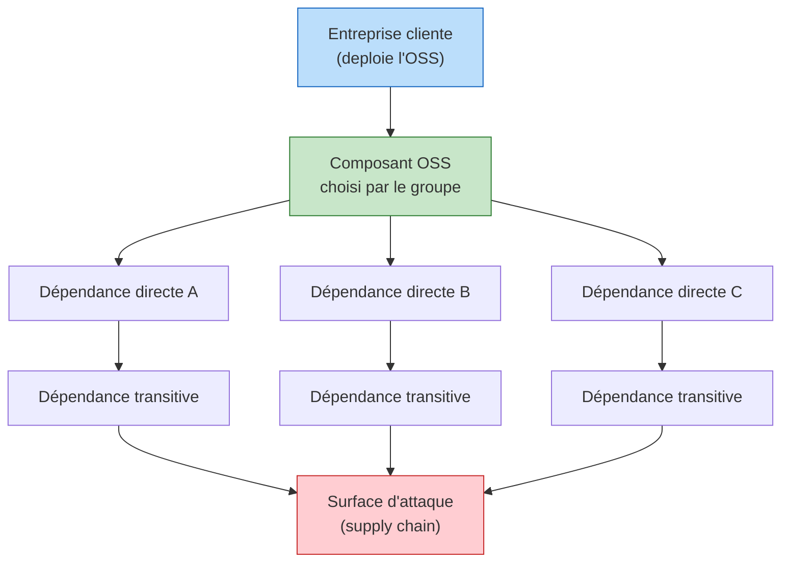
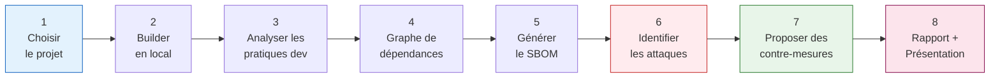
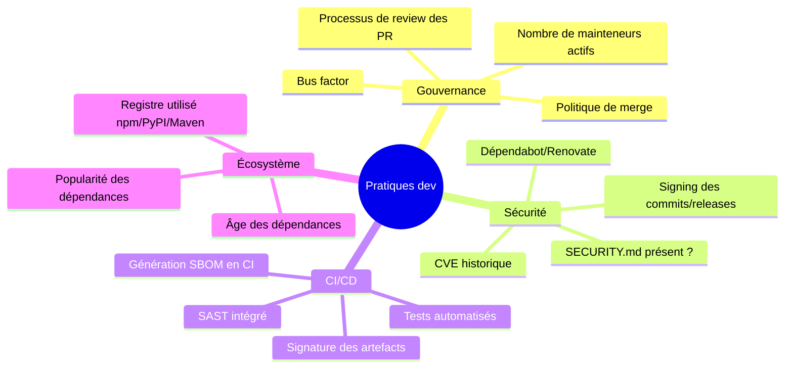
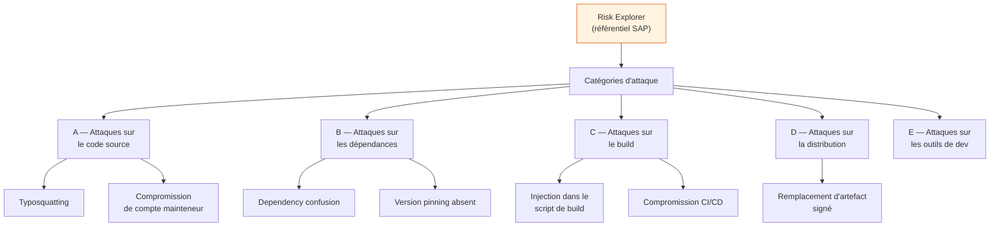
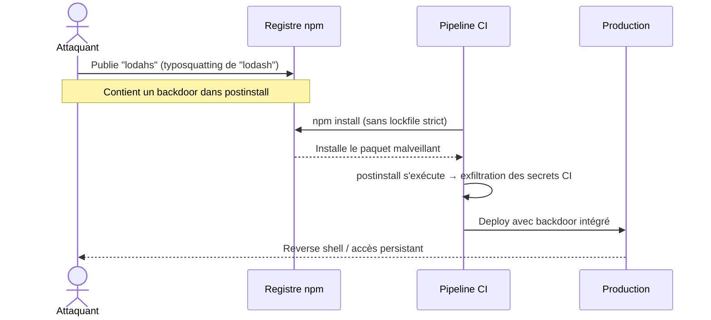
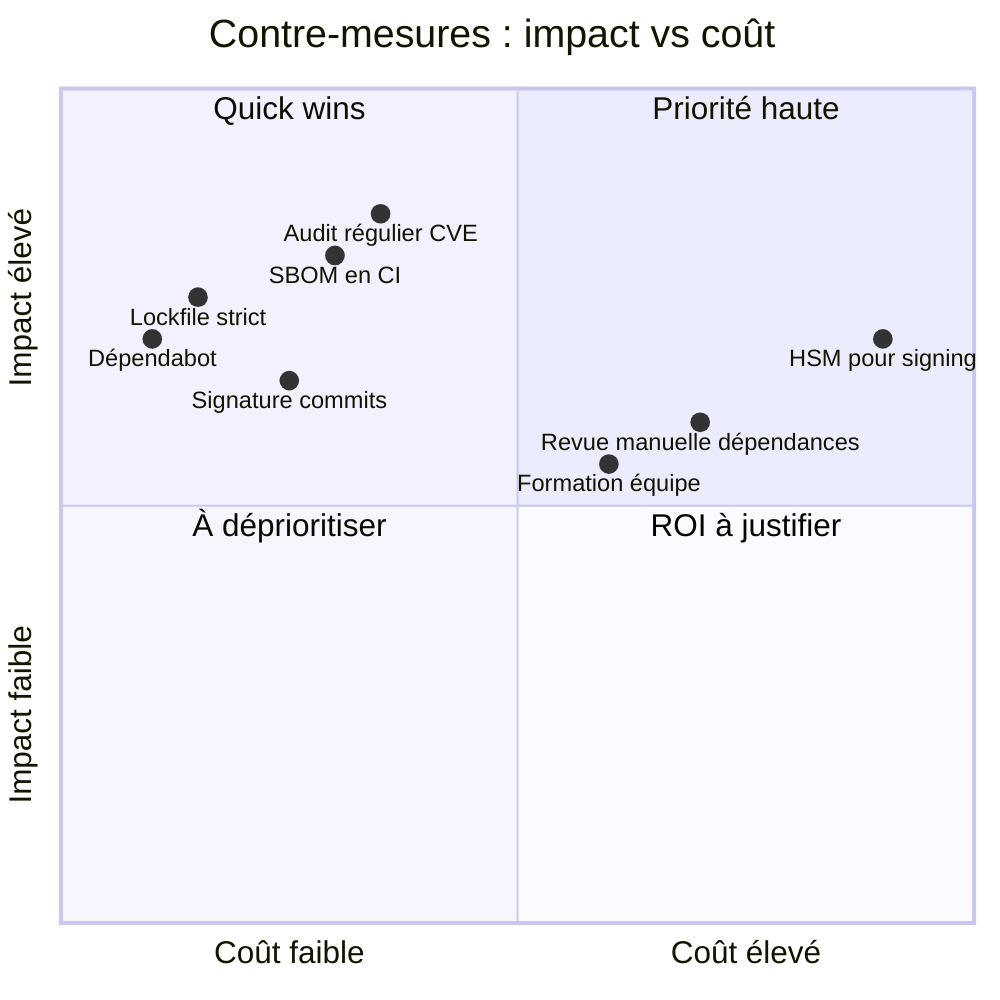

import { LinkCard, CardGrid } from '@astrojs/starlight/components';


Vous jouez le rôle d'un **consultant en sécurité** mandaté pour conduire un audit de la *software supply chain* d'un composant open source déployé chez un client. L'objectif : identifier les risques, construire des scénarios d'attaque réalistes et proposer des contre-mesures chiffrées.

---

## Contexte et enjeux

Les attaques sur la supply chain logicielle ont explosé ces dernières années : SolarWinds (2020), Log4Shell (2021), XZ Utils (2024)… Un composant open source n'est pas un bloc monolithique — c'est un graphe de dépendances, chacune avec son propre historique, ses contributeurs, ses vulnérabilités et ses vecteurs d'attaque.



L'outil [**Risk Explorer for Software Supply Chains**](https://sap.github.io/risk-explorer-for-software-supply-chains/) (SAP Open Source) catalogue les techniques d'attaque sur la supply chain et les met en regard des contre-mesures. Vous l'utiliserez comme référentiel tout au long du projet.

---

## Organisation

| | |
|---|---|
| **Taille des groupes** | 2, 3 ou 4 étudiant·es |
| **Durée** | 7 × 1h30 en TD + travail personnel |
| **Rendu** | Rapport d'audit + présentation |
| **Soutenance** | 30 min — 20 min de présentation + 10 min de questions |
| **Date limite** | Mi-mai |

:::tip[Choix du projet]
Choisissez de préférence un projet **déployé dans l'entreprise d'un membre du groupe** : vous aurez accès à des contraintes réelles (contraintes d'upgrade, dépendances internes, contexte de déploiement). Seul prérequis : le projet doit être **open source**.
:::

---

## Projets suggérés

La liste ci-dessous est non exhaustive. Vous êtes libres de proposer un autre projet.

<CardGrid>
  <LinkCard title="CodiMD" href="https://github.com/hackmdio/codimd" description="Éditeur collaboratif Markdown (Node.js, PostgreSQL)" />
  <LinkCard title="django-CMS" href="https://www.django-cms.org/" description="CMS Python/Django, très utilisé en production" />
  <LinkCard title="cal.com" href="https://github.com/calcom/cal.com" description="Plateforme de scheduling (Next.js, Prisma, TypeScript)" />
  <LinkCard title="Pydio" href="https://pydio.com/fr" description="Gestionnaire de fichiers d'entreprise (Go, React)" />
  <LinkCard title="FileSender" href="https://github.com/filesender" description="Transfert sécurisé de fichiers volumineux (PHP, SimSharingMan)" />
  <LinkCard title="Jitsi Meet" href="https://github.com/jitsi/jitsi-meet" description="Visioconférence open source (Java, React, WebRTC)" />
  <LinkCard title="Gitea" href="https://github.com/go-gitea/gitea" description="Forge Git légère (Go, SQLite/PostgreSQL)" />
  <LinkCard title="Evento/Moment" href="https://sourcesup.renater.fr/projects/moment/" description="Gestion d'événements académiques (PHP)" />
</CardGrid>

---

## Méthodologie — 8 étapes



### Étape 1 — Choisir le projet

Choisissez un projet open source et documentez votre choix :

- Pourquoi ce projet ? Quel est le contexte de déploiement chez votre client fictif (ou réel) ?
- Quelle version est déployée en production ?
- Quel langage, quel écosystème (npm, PyPI, Maven, Go modules…) ?
- Quelle est la taille de la communauté (étoiles GitHub, contributeurs actifs, fréquence des releases) ?

### Étape 2 — Construire et exécuter le projet en local

L'objectif est de comprendre le projet de l'intérieur, pas seulement de le lire.

```bash
# Exemple pour un projet Node.js
git clone <url-du-projet>
cd <projet>
# Lire README, CONTRIBUTING, SECURITY.md
# Builder avec les outils natifs du projet
npm install && npm run build
# Lancer les tests
npm test
```

:::caution[Isoler le build]
Utilisez un environnement isolé (Docker, `uv` pour Python, `guix shell` pour une isolation maximale — cf. TP4) pour ne pas polluer votre machine de dev et pour reproduire les conditions de build exactes.
:::

Documentez les prérequis système, les scripts de build, et tout ce qui s'écarte du chemin nominal.

### Étape 3 — Analyser les pratiques de développement

Pour chaque critère, notez l'état actuel et évaluez le risque associé :



Outils utiles :

```bash
# Statistiques de commits et contributeurs
git log --shortstat --since="1 year ago" | grep "Author:" | sort | uniq -c | sort -rn | head -20

# Vérifier la présence de fichiers de sécurité
ls SECURITY.md .github/SECURITY.md CODEOWNERS

# Vérifier la signature des releases
gh release list --repo <org>/<repo>
```

:::note[Bus factor]
Un projet avec 1 ou 2 mainteneurs actifs a un **bus factor** très faible : si ces personnes arrêtent de contribuer (burnout, changement d'emploi), le projet peut devenir unmaintained en quelques mois. C'est un risque de supply chain à part entière.
:::

### Étape 4 — Analyser le graphe de dépendances

L'objectif est de **visualiser et quantifier** la surface d'attaque transitive.

```bash
# Node.js — arbre de dépendances
npm ls --all 2>/dev/null | head -100
npx depcruise --include-only "^src" --output-type dot src | dot -T svg > deps.svg

# Python (uv)
uv tree
uv pip list --format=json | jq '.[].name' | wc -l

# Go
go mod graph | head -50
govulncheck ./...

# Java/Maven
mvn dependency:tree -Dverbose
```

Produisez une visualisation du graphe et répondez à ces questions :
- Combien de dépendances directes ? Transitives ?
- Quelles sont les 5 dépendances les plus téléchargées par semaine (npm/PyPI) ?
- Y a-t-il des dépendances avec un seul mainteneur ?
- Quelles dépendances n'ont pas été mises à jour depuis plus de 2 ans ?

### Étape 5 — Générer le SBOM

Utilisez les outils vus en **TP3** pour générer un SBOM au format CycloneDX :

```bash
# Python (uv + CycloneDX)
uv run cyclonedx-py environment -o sbom.json --format json
uv run cyclonedx-py environment -o sbom.xml --format xml

# Node.js
npx @cyclonedx/cyclonedx-npm --output-file sbom.json

# Java
mvn org.cyclonedx:cyclonedx-maven-plugin:makeAggregateBom

# Go
go install github.com/CycloneDX/cyclonedx-gomod/cmd/cyclonedx-gomod@latest
cyclonedx-gomod app -output sbom.json

# Docker image (analyse de l'image buildée)
trivy image --format cyclonedx --output sbom-image.json <image>:<tag>
```

Analysez le SBOM obtenu :

```bash
# Chercher des CVE connues dans le SBOM
grype sbom:sbom.json

# Ou avec OSV-Scanner
osv-scanner --sbom sbom.json
```

:::tip[SBOM en CI]
Intégrez la génération du SBOM dans la CI du projet (`.gitlab-ci.yml` ou `.github/workflows/`) comme vous l'avez fait en TP3. Le SBOM doit être un artefact de chaque build.
:::

### Étape 6 — Identifier les techniques d'attaque

Utilisez le **Risk Explorer** (https://sap.github.io/risk-explorer-for-software-supply-chains/) pour identifier les techniques applicables à votre projet.



**Pour chacun des 3 scénarios d'attaque**, documentez :

| Critère | Description |
|---------|-------------|
| **Nom** | Identifiant dans le Risk Explorer (ex. : `SFY-04`) |
| **Vecteur** | Comment l'attaque entre dans le projet |
| **Prérequis** | Ce dont l'attaquant a besoin |
| **Chemin d'attaque** | Étapes détaillées, du point d'entrée à l'impact |
| **Impact** | Confidentialité / Intégrité / Disponibilité |
| **Complexité** | Faible / Moyenne / Élevée — justifiée |
| **Preuve de concept** | Montrez pourquoi ce vecteur **est applicable** à ce projet précis |

:::danger[Éthique et légalité]
Les analyses doivent rester **théoriques ou sur votre fork local**. Il est interdit de tester des attaques sur des instances en production, même publiques. Tout test doit se faire dans un environnement contrôlé que vous avez vous-même mis en place à l'étape 2.
:::

**Exemple de scénario à documenter :**



### Étape 7 — Proposer des contre-mesures

Pour chaque attaque identifiée, proposez la contre-mesure correspondante et évaluez son coût de mise en œuvre.



Pour chaque contre-mesure :
- **Référence** dans le Risk Explorer (colonne "Mitigations")
- **Effort estimé** : heures de mise en place + maintenance annuelle
- **Réduction du risque** : quelle(s) attaque(s) elle neutralise/atténue
- **Dépendances organisationnelles** : faut-il l'accord d'une équipe infra ? Une politique d'entreprise ?
- **Mise en œuvre concrète** : fichiers de config, scripts, intégration CI

Exemples de contre-mesures à évaluer :

```bash
# 1. Figer les dépendances transitives (npm)
npm ci  # utilise package-lock.json strictement
# ou avec integrity checks
npm install --package-lock-only
npm audit signatures

# 2. Vérifier l'intégrité des dépendances (Python/uv)
uv lock --locked   # échoue si le lockfile a changé

# 3. Configurer Dependabot
# .github/dependabot.yml
# version: 2
# updates:
#   - package-ecosystem: "npm"
#     directory: "/"
#     schedule:
#       interval: "weekly"

# 4. Signer les commits (voir TP1)
git config --global commit.gpgsign true

# 5. Vérifier les hachages des artefacts téléchargés
sha256sum artefact.tar.gz
# comparer avec le hachage publié sur la release GitHub
```

:::note[Analyse coût/bénéfice]
Le rapport doit montrer une **analyse critique** : une contre-mesure qui coûte 3 mois-ingénieur pour réduire un risque faible n'est pas forcément recommandable. L'objectif est de proposer un plan réaliste et priorisé, pas une liste exhaustive d'idéaux.
:::

### Étape 8 — Rapport et présentation

---

## Livrables

### Rapport d'audit (rendu mi-mai)

Le rapport doit couvrir :

1. **Présentation du projet** — contexte, version étudiée, déploiement chez le client
2. **Analyse des pratiques de développement** — gouvernance, CI/CD, sécurité, synthèse avec score
3. **Graphe de dépendances** — visualisation, métriques clés (depth, breadth, single-maintainer deps)
4. **SBOM** — méthodologie de génération, CVE identifiées, statistiques
5. **3 scénarios d'attaque** — complets (vecteur, chemin, impact, complexité, preuve d'applicabilité)
6. **Recommandations** — contre-mesures priorisées avec analyse coût/bénéfice
7. **Conclusion** — évaluation globale du risque supply chain, roadmap des actions prioritaires

:::tip[Format du rapport]
Pas de format imposé (PDF, site web, notebook…). La clarté, la rigueur et la capacité à argumenter comptent plus que la forme. Les diagrammes (graphe de dépendances, chemins d'attaque) doivent être inclus.
:::

### Présentation orale (soutenance 30 minutes)

**20 minutes de présentation + 10 minutes de questions.**

Structure suggérée :

```mermaid
gantt
    title Déroulé suggéré de la présentation (20 min)
    dateFormat mm
    axisFormat %M min

    section Intro
    Contexte et projet choisi       :00, 2m
    section Analyse
    Pratiques dev + graphe deps     :02, 4m
    SBOM et vulnérabilités          :06, 3m
    section Attaques
    Scénario 1                      :09, 3m
    Scénario 2 et 3 (synthèse)      :12, 3m
    section Défense
    Contre-mesures et priorisation  :15, 4m
    Conclusion                      :19, 1m
```



---

## Critères d'évaluation

| Critère | Poids | Description |
|---------|-------|-------------|
| Rigueur technique | 30 % | SBOM généré et analysé, outils correctement utilisés |
| Pertinence des scénarios | 25 % | Attaques réalistes, applicables au projet choisi, bien justifiées |
| Qualité des recommandations | 25 % | Contre-mesures chiffrées, priorisées, réalistes |
| Présentation et communication | 20 % | Clarté, pédagogie, capacité à répondre aux questions |

:::caution[Originalité]
Chaque groupe travaille sur un projet différent. Si deux groupes choisissent le même projet, ils doivent étudier des versions différentes ou aborder des aspects complémentaires. Validez votre choix rapidement pour éviter les doublons.
:::

---

## Ressources et outils

### Référentiels d'attaque
- [Risk Explorer for Software Supply Chains (SAP)](https://sap.github.io/risk-explorer-for-software-supply-chains/)
- [SLSA Framework](https://slsa.dev/) — niveaux de maturité supply chain
- [OpenSSF Scorecard](https://securityscorecards.dev/) — scoring automatique des pratiques de sécurité
- [OWASP Top 10 CI/CD Security Risks](https://owasp.org/www-project-top-10-ci-cd-security-risks/)

### Génération et analyse SBOM
- CycloneDX (vu en TP3) — format SBOM multi-langages
- [Syft](https://github.com/anchore/syft) — génération SBOM depuis images Docker
- [Grype](https://github.com/anchore/grype) — scan de vulnérabilités sur SBOM
- [OSV-Scanner](https://github.com/google/osv-scanner) — Google, multi-écosystèmes

### Analyse des dépendances
- [deps.dev](https://deps.dev/) — API Google pour analyser les dépendances
- [Snyk Open Source](https://snyk.io/product/open-source-security/) — analyse de vulnérabilités
- [Socket.dev](https://socket.dev/) — détection d'attaques sur npm/PyPI

### Scoring des pratiques open source
```bash
# OpenSSF Scorecard — scoring automatique via GitHub Actions
docker run -e GITHUB_AUTH_TOKEN=<token> \
  gcr.io/openssf/scorecard:stable \
  --repo github.com/<org>/<projet>
```

---

## Rappel des outils des TPs précédents

Les outils vus dans les TPs 1 à 4 sont directement réutilisables dans ce projet :

| Outil | TP | Usage dans le projet |
|-------|-----|---------------------|
| `uv` | TP1 | Isoler l'environnement Python, générer le SBOM |
| `bandit` | TP3 | SAST sur le code source Python du projet |
| `gitleaks` | TP3 | Scanner l'historique git pour des secrets exposés |
| `cyclonedx-py` | TP3 | Générer le SBOM au format CycloneDX |
| `guix shell` | TP4 | Reproductibilité du build pour les analyses |
| GitLab CI | TP1/TP3 | Intégrer SBOM et scans dans la CI du projet forké |

:::tip[Fork du projet]
Forkez le projet sur votre GitLab personnel et mettez en place le pipeline CI/CD vu en TP3. Cela vous permettra de montrer concrètement les contre-mesures que vous avez implémentées.
:::
