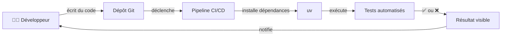
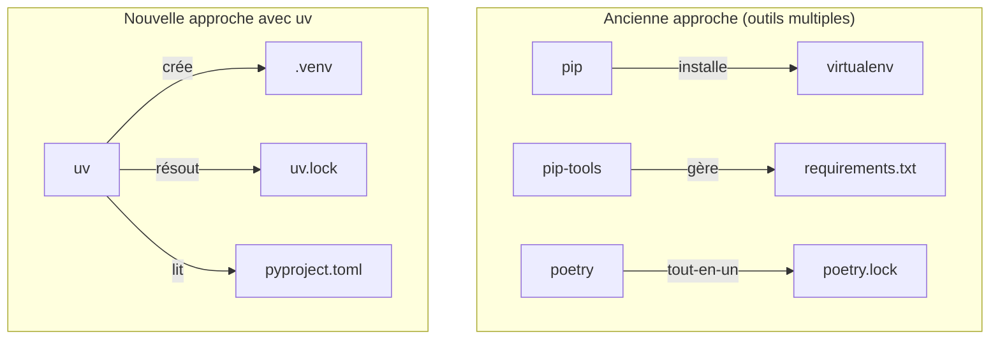
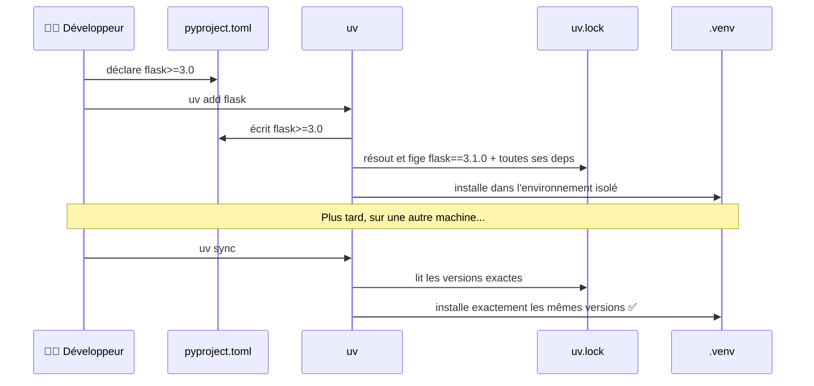
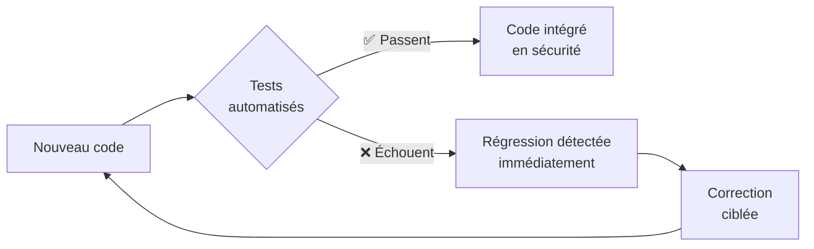
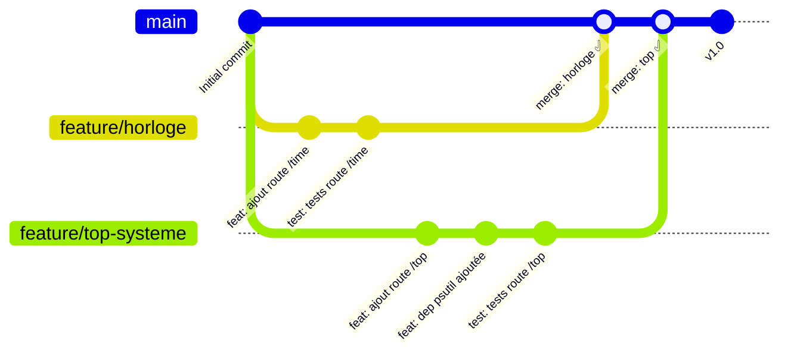
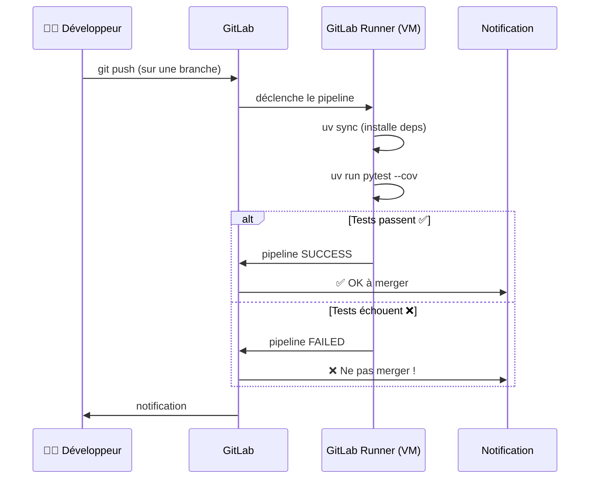

> **Durée** : 3 × 1h30  
> **Objectifs** : Maîtriser `uv`, l'outil moderne de gestion de dépendances Python, utiliser Git en équipe selon le GitFlow, et mettre en place une chaîne d'intégration continue sur GitLab.

---

## Pourquoi ce TP ?

Dans un projet logiciel professionnel, écrire du code n'est que la partie émergée de l'iceberg. Il faut aussi :

- **Gérer les dépendances** : quelles bibliothèques utilise-t-on ? Dans quelles versions ? Comment s'assurer que tout le monde dans l'équipe (et les serveurs de production) utilisent exactement les mêmes versions ?
- **Collaborer** : comment éviter que deux développeurs ne se "marchent dessus" ?
- **Automatiser** : comment vérifier en permanence que le code fonctionne, sans effort manuel ?

Ce TP vous fait découvrir les outils qui répondent à ces trois questions.



---

## Étape 0 : Mise en place de l'environnement

### Installation de Python

`uv` peut gérer les versions de Python lui-même (voir plus bas), mais il est recommandé d'avoir Python 3.11+ installé sur votre machine.

- [Téléchargement Python](https://www.python.org/downloads/)
- [Guide d'installation Windows](https://kinsta.com/knowledgebase/install-python/)

Vérifiez votre installation :

```bash
python3 --version
# Python 3.12.x
```

---

## Étape 1 : Découverte de `uv`

### Qu'est-ce que `uv` ?

`uv` est un outil de gestion de dépendances et d'environnements Python écrit en **Rust**, développé par Astral (les créateurs de `Ruff`, le linter Python ultra-rapide). Il remplace en un seul outil : `pip`, `pip-tools`, `pipenv`, `virtualenv` et `poetry`.

> **Pourquoi Rust ?** Rust est un langage compilé qui produit des binaires natifs très performants. Résultat : `uv` est **10 à 100 fois plus rapide** que `pip` ou `poetry`.

**Comparaison des outils :**



### Les deux fichiers clés

Comme `poetry`, `uv` s'appuie sur deux fichiers essentiels :

**`pyproject.toml`** — La "recette" du projet. Vous y déclarez vos dépendances avec des contraintes de versions (ex. `flask>=3.0`). C'est le fichier que vous éditez manuellement.

**`uv.lock`** — Le "snapshot" exact. `uv` y consigne les versions précises de **toutes** les dépendances (y compris les dépendances de vos dépendances). Ce fichier est généré automatiquement et doit être **committé dans Git**.



> **Règle d'or** : `pyproject.toml` exprime votre *intention* (versions compatibles), `uv.lock` garantit la *reproductibilité* (versions exactes). Committez toujours les deux.

### Installation de `uv`

```bash
# Sur Linux / macOS
curl -LsSf https://astral.sh/uv/install.sh | sh

# Sur Windows (PowerShell)
powershell -ExecutionPolicy ByPass -c "irm https://astral.sh/uv/install.ps1 | iex"
```

Après installation, **ouvrez un nouveau terminal** et vérifiez :

```bash
uv --version
# uv 0.5.x (ou plus récent)
```

> **Note** : `uv` peut aussi installer et gérer des versions de Python pour vous avec `uv python install 3.12`. Pratique sur les machines où Python n'est pas disponible !

---

## Étape 2 : Création d'un projet web avec Flask

### Initialisation du projet

```bash
# Créer un dossier de travail
mkdir tp1sys
cd tp1sys

# Créer un nouveau projet Python géré par uv
uv init tp1flask
cd tp1flask
```

La commande `uv init` crée la structure suivante :

```
tp1flask/
├── .python-version    ← version de Python utilisée pour ce projet
├── pyproject.toml     ← configuration et dépendances du projet
├── README.md
└── hello.py           ← fichier exemple (on le supprimera)
```

Regardons le contenu de `pyproject.toml` généré :

```toml
[project]
name = "tp1flask"
version = "0.1.0"
description = "Add your description here"
readme = "README.md"
requires-python = ">=3.12"
dependencies = []          # ← vide pour l'instant
```

### Ajout de la dépendance Flask

```bash
# Ajouter Flask comme dépendance du projet
uv add flask
```

`uv` va :
1. Télécharger Flask et toutes ses dépendances depuis PyPI
2. Mettre à jour `pyproject.toml`
3. Générer (ou mettre à jour) `uv.lock`
4. Installer le tout dans `.venv/`

> **Observez** la vitesse d'exécution ! Sur un projet avec beaucoup de dépendances, la différence avec `pip` est spectaculaire.

Après `uv add flask`, `pyproject.toml` contient :

```toml
[project]
dependencies = [
    "flask>=3.1.0",
]
```

### Création de l'application Flask

Supprimez le fichier `hello.py` et créez la structure suivante :

```bash
mkdir -p src/tp1flask
touch src/__init__.py          # src doit être un package Python
touch src/tp1flask/__init__.py # tp1flask aussi
```

Créez le fichier `src/tp1flask/main.py` :

```python
from flask import Flask


def create_app():
    """Fabrique d'application Flask (Application Factory pattern)."""
    app = Flask(__name__)

    @app.route("/")
    def hello_world():
        return "<p>Hello, World!</p>"

    return app


# Point d'entrée pour le développement
if __name__ == "__main__":
    app = create_app()
    app.run(debug=True)
```

> **Pourquoi une fonction `create_app()` ?** C'est le pattern "Application Factory" recommandé par Flask. Il permet d'instancier l'application avec différentes configurations (développement, test, production) et facilite les tests unitaires, comme vous le verrez à l'étape suivante.

### Lancement de l'application

```bash
# Lancer le serveur de développement Flask
uv run flask --app src.tp1flask.main run
```

Ouvrez votre navigateur sur [http://127.0.0.1:5000](http://127.0.0.1:5000) — vous devriez voir "Hello, World!".

> **Que fait `uv run` ?** Il exécute la commande dans l'environnement virtuel `.venv` du projet, sans avoir besoin de l'activer manuellement. C'est l'équivalent de `poetry run`.

**Alternative : activer l'environnement manuellement**

```bash
# Activer le venv (Linux/macOS)
source .venv/bin/activate

# Activer le venv (Windows)
.venv\Scripts\activate

# Puis lancer directement
flask --app src.tp1flask.main run

# Pour quitter l'environnement activé
deactivate
```

---

## Étape 3 : Tests automatisés

### Pourquoi tester ?



Les tests automatisés permettent de détecter les **régressions** : un bug introduit involontairement lors d'une modification. Sans eux, vous ne savez pas si votre nouveau code "casse" quelque chose qui fonctionnait avant.

### Ajout des dépendances de test

Nous utilisons [pytest](https://pytest.org/) avec l'extension `pytest-flask`. Ces dépendances ne sont nécessaires **qu'en développement** (pas en production), on les place donc dans un groupe séparé :

```bash
# --dev ajoute au groupe "dev" (non installé en production)
uv add --dev pytest-flask pytest-cov
```

Dans `pyproject.toml`, un nouveau groupe apparaît :

```toml
[dependency-groups]
dev = [
    "pytest-flask>=1.3.0",
    "pytest-cov>=6.0.0",
]
```

### Configuration de pytest

Ajoutez cette section dans `pyproject.toml` pour indiquer à pytest où chercher les tests et le code source :

```toml
[tool.pytest.ini_options]
pythonpath = ["."]
testpaths = ["tests"]
```

### La fixture pytest : configurer l'environnement de test

Créez le répertoire `tests/` et le fichier `tests/conftest.py` :

```python
# tests/conftest.py
import pytest
from src.tp1flask.main import create_app


@pytest.fixture
def client():
    """Fournit un client HTTP de test pour l'application Flask."""
    app = create_app()
    # Activer le mode test désactive la gestion des erreurs Flask
    # pour que pytest puisse les attraper directement
    app.config["TESTING"] = True
    with app.test_client() as client:
        yield client
```

> **Qu'est-ce qu'une fixture ?** En pytest, une fixture est une fonction qui prépare un contexte réutilisable pour vos tests. Ici, elle crée un "faux client HTTP" qui peut envoyer des requêtes à votre app sans démarrer un vrai serveur.

### Écrire les tests

Créez `tests/test_app.py` :

```python
# tests/test_app.py


def test_should_status_code_ok(client):
    """La route / doit retourner un code HTTP 200 (succès)."""
    response = client.get("/")
    assert response.status_code == 200


def test_should_contain_helloworld(client):
    """La route / doit retourner le texte 'Hello, World!'."""
    response = client.get("/")
    data = response.data.decode()  # bytes → str
    assert data == "<p>Hello, World!</p>"
```

> **Convention de nommage** : pytest découvre automatiquement les tests dont le nom commence par `test_`. Pas besoin de les déclarer nulle part.

### Exécuter les tests

```bash
# Lancer tous les tests
uv run pytest

# Avec le rapport de couverture de code
uv run pytest --cov=src
```

Résultat attendu :

```
========================== test session starts ===========================
collected 2 items

tests/test_app.py ..                                               [100%]

========================== 2 passed in 0.42s ============================
```

Avec la couverture :

```
---------- coverage: platform linux, python 3.12.x ---------
Name                       Stmts   Miss  Cover
----------------------------------------------
src/tp1flask/__init__.py       0      0   100%
src/tp1flask/main.py           9      0   100%
----------------------------------------------
TOTAL                          9      0   100%
```

> ⚠️ **Important** : 100% de couverture ne signifie pas que vos tests sont bons ! Ça signifie seulement que chaque ligne de code a été *exécutée* au moins une fois. Un test qui ne vérifie rien peut donner 100% de couverture. La couverture est un indicateur utile mais insuffisant.

**Bravo !** Vous avez maintenant une application avec :
- Un gestionnaire de dépendances moderne (`uv`)
- Des tests automatisés (`pytest`)
- Une mesure de couverture de code

---

## Étape 4 : Travail collaboratif avec Git

### Mise en place du dépôt GitLab

Connectez-vous sur le GitLab de l'ISTIC : [https://gitlab2.istic.univ-rennes1.fr/](https://gitlab2.istic.univ-rennes1.fr/)

**Un seul membre du binôme** crée un projet vide (*Blank project*).

> ⚠️ Désélectionnez "Initialize repository with a README" pour garder le dépôt vide.

### Initialisation de Git en local

```bash
# Configurer votre identité Git (à faire une seule fois par machine)
git config --global user.name "Prénom Nom"
git config --global user.email "votre.email@univ-rennes1.fr"

# Initialiser le dépôt local
git init --initial-branch=main

# Lier au dépôt distant GitLab
# ⚠️ Remplacez l'URL par celle de VOTRE projet GitLab
git remote add origin git@gitlab.istic.univ-rennes1.fr:VOTRE_LOGIN/tp1flask.git

# Télécharger un .gitignore adapté à Python
wget https://raw.githubusercontent.com/github/gitignore/main/Python.gitignore
mv Python.gitignore .gitignore
```

**Vérifiez votre `.gitignore`** : il doit ignorer `.venv/` pour ne pas committer l'environnement virtuel (lourd et spécifique à chaque machine). Ajoutez-y la ligne `.venv` si elle n'y est pas.

```bash
echo ".venv" >> .gitignore
```

### Premier commit

```bash
# Voir l'état actuel (tous les fichiers sont "non suivis")
git status

# Ajouter les fichiers pertinents
git add pyproject.toml uv.lock src/ tests/ README.md .gitignore .python-version

# Créer le premier snapshot
git commit -m "feat: initialisation du projet tp1flask avec uv et tests"

# Envoyer vers GitLab
git push --set-upstream origin main
```

> **Convention de messages de commit** : préfixez vos messages avec `feat:` (nouvelle fonctionnalité), `fix:` (correction), `test:` (ajout de tests), `ci:` (intégration continue), `docs:` (documentation). C'est la [convention Conventional Commits](https://www.conventionalcommits.org/), largement adoptée dans l'industrie.

### Cloner le projet (membre 2 du binôme)

```bash
# Cloner le dépôt
git clone git@gitlab.istic.univ-rennes1.fr:LOGIN_MEMBRE1/tp1flask.git
cd tp1flask

# Installer toutes les dépendances (lit uv.lock pour les versions exactes)
uv sync --dev   # installe les dépendances de dev (pytest, etc.)

# Vérifier que tout fonctionne
uv run pytest --cov=src
```

---

## Étape 5 : GitFlow — travailler sur des branches

### Concept du GitFlow

Le GitFlow est une convention d'organisation des branches Git. L'idée centrale : **on ne code jamais directement sur `main`**.



### Nouvelles fonctionnalités à implémenter

Vous allez ajouter **deux routes** à l'application :

1. **`/time`** — retourne l'heure actuelle du serveur  
2. **`/top`** — retourne des informations système (CPU, mémoire) au format HTML

### Protection de la branche `main`

Avant de créer des branches, protégez `main` pour qu'aucun push direct ne soit possible.

Dans GitLab : **Settings → Repository → Protected branches** → ajoutez une règle sur `main` : *Allowed to push: No one*, *Allowed to merge: Maintainers*.

### Workflow pour chaque fonctionnalité

**1. Créer un ticket (Issue) dans GitLab**

Dans GitLab : **Issues → New issue**. Créez un ticket pour chaque fonctionnalité.

**2. Créer une branche depuis le ticket**

Depuis la page du ticket : *Create branch* (GitLab crée la branche automatiquement avec un nom normalisé).

**3. Se synchroniser et basculer sur la branche**

```bash
# Récupérer les nouvelles branches depuis GitLab
git fetch

# Basculer sur la branche créée (remplacez NAMEOFTHEBRANCH)
git checkout NAMEOFTHEBRANCH
```

**Le membre 1** travaille sur `/time`, **le membre 2** sur `/top`.

### Implémentation : route `/time`

```python
# À ajouter dans src/tp1flask/main.py
from datetime import datetime

@app.route("/time")
def server_time():
    now = datetime.now()
    return f"<p>Il est actuellement : {now.strftime('%H:%M:%S le %d/%m/%Y')}</p>"
```

### Implémentation : route `/top`

Pour la route `/top`, vous aurez besoin de la bibliothèque `psutil` :

```bash
uv add psutil
```

```python
# À ajouter dans src/tp1flask/main.py
import psutil

@app.route("/top")
def system_top():
    cpu = psutil.cpu_percent(interval=0.5)
    mem = psutil.virtual_memory()
    return f"""
    <h2>État du système</h2>
    <p>CPU : {cpu}%</p>
    <p>Mémoire utilisée : {mem.percent}% 
       ({mem.used // 1024 // 1024} Mo / {mem.total // 1024 // 1024} Mo)</p>
    """
```

### Commits et Merge Request

```bash
# Committer votre travail
git add src/tp1flask/main.py tests/test_app.py pyproject.toml uv.lock
git commit -m "feat: ajout de la route /time (closes #1)"

# Pousser la branche
git push
```

Dans GitLab, créez une **Merge Request** depuis votre branche vers `main`. Le **co-équipier** (qui n'a pas écrit ce code) relit et valide la Merge Request.

> **Pourquoi faire relire par l'autre ?** Le regard extérieur permet de détecter des bugs, des oublis ou des problèmes de lisibilité que l'auteur ne voit plus. C'est la pratique de **code review**, incontournable dans les équipes professionnelles.

---

## Étape 6 : Intégration continue (CI/CD)

### Rappel : pourquoi l'IC ?

> L'intégration continue (*Continuous Integration*) consiste à vérifier **automatiquement**, à chaque modification du code, que rien n'est cassé. Les tests sont lancés sur un serveur neutre à chaque push ou Merge Request.



### Création d'une VM à l'ISTIC

Rendez-vous sur [https://vm.istic.univ-rennes1.fr](https://vm.istic.univ-rennes1.fr) et créez une VM **Ubuntu 22.04**.

### Installation du Runner GitLab

Connectez-vous en SSH sur votre VM, puis :

```bash
# Télécharger le binaire GitLab Runner compatible avec l'ISTIC
curl -LJO "https://gitlab.com/gitlab-org/gitlab-runner/-/releases/v16.5.0/downloads/binaries/gitlab-runner-linux-amd64"
chmod +x gitlab-runner-linux-amd64
```

> ⚠️ Utilisez bien la version **v16.5.0** pour être compatible avec le GitLab de l'ISTIC.

### Préparation de la VM

Avant d'enregistrer le runner, installez les dépendances nécessaires :

```bash
sudo apt update && sudo apt -y upgrade
sudo apt install -y git python3 python3-pip curl

# Installer uv pour l'utilisateur gitlab-runner
sudo -i -u gitlab-runner bash -c "curl -LsSf https://astral.sh/uv/install.sh | sh"
```

### Enregistrement du Runner

Dans GitLab : **Settings → CI/CD → Runners → New project runner**.

Choisissez un tag (ex. `uvrunner`) — ce tag permet d'associer des jobs à ce runner précis.

Copiez la commande d'enregistrement affichée et lancez-la sur la VM :

```bash
./gitlab-runner-linux-amd64 register \
  --url https://gitlab.istic.univ-rennes1.fr \
  --token VOTRE_TOKEN_ICI
```

Choisissez **shell** comme executor. Puis démarrez le runner :

```bash
./gitlab-runner-linux-amd64 run
```

### Création du fichier `.gitlab-ci.yml`

Créez un ticket et une branche dédiés à la mise en place de la CI.

Dans GitLab, **Build → Pipeline editor → Create new CI/CD configuration file** (sélectionnez votre branche, **pas** `main`).

Voici un pipeline complet :

```yaml
# .gitlab-ci.yml

stages:
  - build
  - test

before_script:
  # Rendre uv disponible dans tous les jobs (installé dans ~/.local/bin)
  - export PATH="$HOME/.local/bin:$PATH"

build-job:
  stage: build
  tags:
    - uvrunner          # ← remplacez par votre tag
  script:
    - echo "▶ Installation des dépendances pour $GITLAB_USER_LOGIN"
    - uv sync --dev
    - echo "✅ Dépendances installées"

test-job:
  stage: test
  tags:
    - uvrunner
  script:
    - echo "▶ Lancement des tests"
    - uv run pytest --cov=src --cov-report=term-missing
  coverage: '/TOTAL.*\s+(\d+%)$/'   # extrait le % de couverture pour GitLab
  rules:
    - if: '$CI_PIPELINE_SOURCE == "merge_request_event"'   # uniquement sur les MR
    - if: '$CI_COMMIT_BRANCH == "main"'                    # et sur main
```

> **Explication des sections :**
> - `stages` : définit l'ordre d'exécution (build d'abord, test ensuite)
> - `tags` : sélectionne le runner qui a ce tag
> - `script` : les commandes shell à exécuter
> - `rules` : conditions de déclenchement (ici : uniquement sur les Merge Requests et sur `main`)
> - `coverage` : expression régulière pour extraire le % de couverture et l'afficher dans l'interface GitLab

Committez ce fichier, créez une Merge Request, et observez le pipeline se déclencher ! 🎉

### Vérifier que la CI "garde la porte"

**Exercice final** : ajoutez intentionnellement une nouvelle route à votre application, **sans écrire de test**. Faites une Merge Request. Observez que la pipeline passe quand même (la couverture baisse mais les tests existants passent toujours). Maintenant, modifiez volontairement la réponse de la route `/` pour qu'elle retourne autre chose que `<p>Hello, World!</p>`. La CI doit détecter l'échec et bloquer la Merge Request. ✅

---

## Étape 7 : Pour aller plus loin avec Git

Faites quelques exercices interactifs pour mieux comprendre les branches et le rebase :

[https://learngitbranching.js.org/?locale=fr_FR](https://learngitbranching.js.org/?locale=fr_FR)

Et pour les plus courageux, le défi ultime :

[https://learngitbranching.js.org/?NODEMO=&command=level+remoteAdvanced8&locale=fr_FR](https://learngitbranching.js.org/?NODEMO=&command=level+remoteAdvanced8&locale=fr_FR)

*(Exercice 3 — Advanced remote)* — un sachet de M&Ms pour celui ou celle qui réussit avec démo et explications ! 🍬

---

## Travail à rendre

Remplissez le formulaire : [https://forms.gle/vyHmZgD6cBw8V6mF7](https://forms.gle/vyHmZgD6cBw8V6mF7)

Votre dépôt GitLab doit contenir :

- ✅ Le code de l'application (`src/tp1flask/main.py`) avec les trois routes (`/`, `/time`, `/top`)
- ✅ Les tests (`tests/`) avec une bonne couverture
- ✅ Les fichiers `pyproject.toml` et `uv.lock`
- ✅ Le fichier `.gitlab-ci.yml` fonctionnel
- ✅ Un historique Git propre (messages de commits clairs, utilisation de branches)
- ✅ Un fichier `README.md` expliquant comment lancer le projet et les tests

**N'oubliez pas** de m'ajouter au projet GitLab (`obarais`) ainsi que votre binôme.

La qualité de l'utilisation de Git (messages de commits, branches, merge requests) sera prise en compte dans la note.
