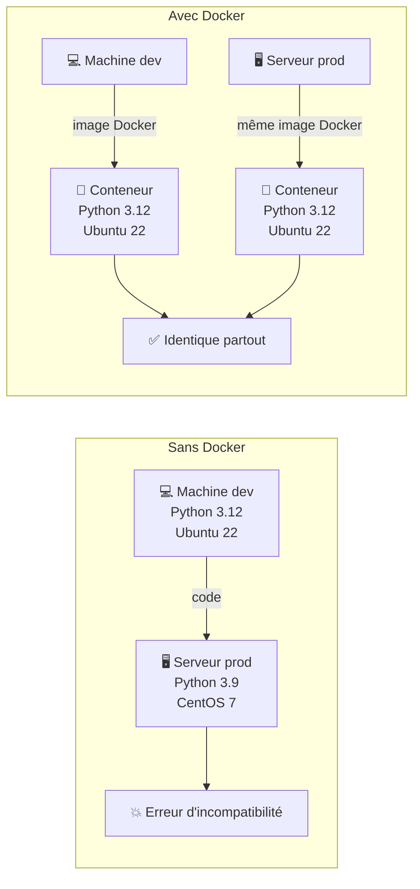
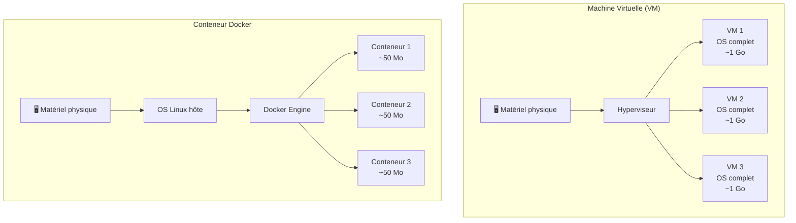
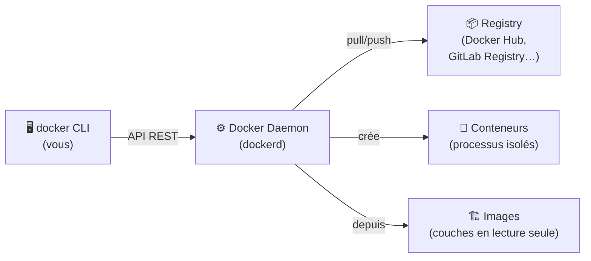
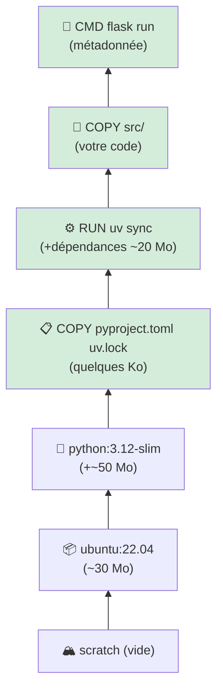
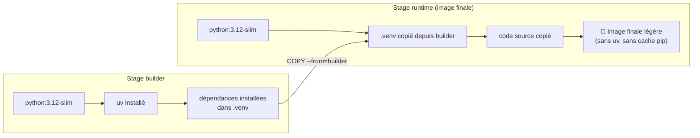
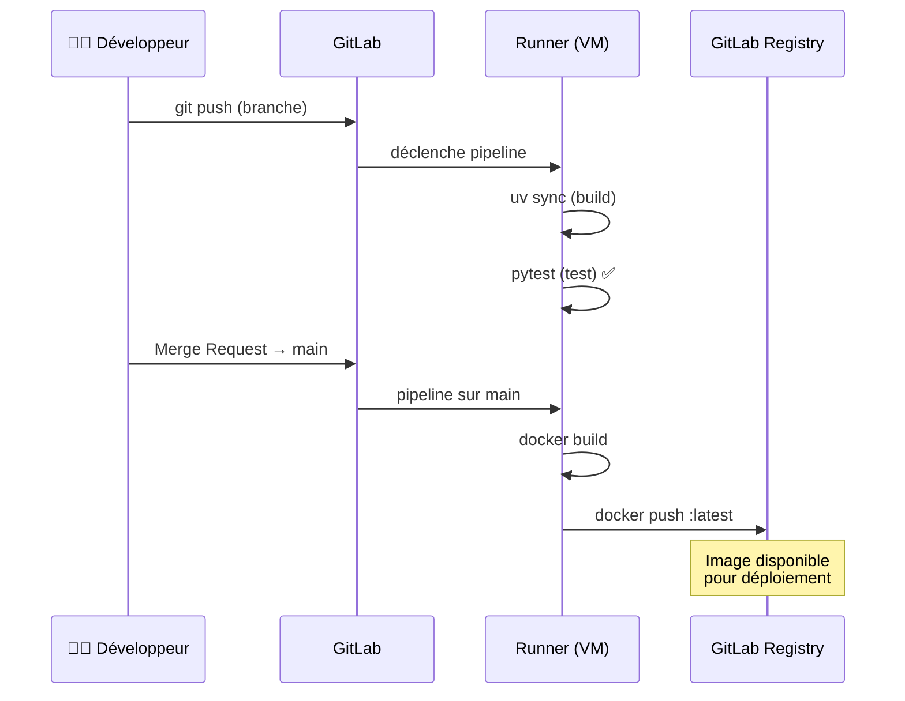
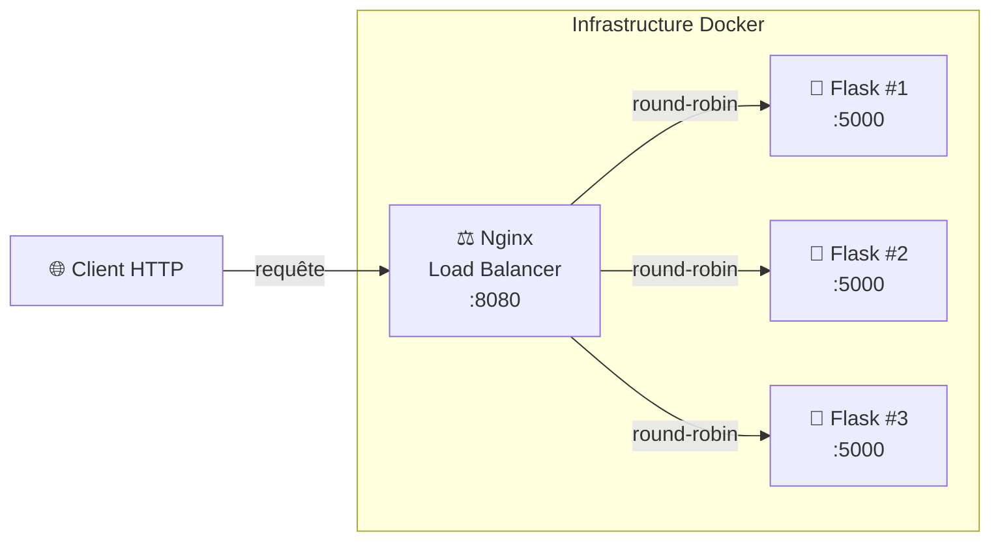
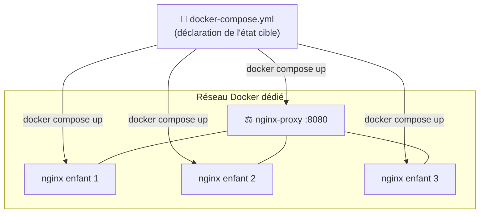

> **Durée** : 3 × 1h30  
> **Prérequis** : TP 1 complété — vous disposez d'une application Flask gérée par `uv` et d'un pipeline CI sur GitLab.

---

## Pourquoi Docker ?

Dans le TP 1, vous avez résolu le problème des dépendances Python avec `uv` : même version de Flask sur toutes les machines. Mais il reste un problème plus profond : votre code tourne sur **votre** système d'exploitation, avec **votre** version de Python, **vos** variables d'environnement, **votre** configuration réseau.

> *"Ça marche sur ma machine"* — le développeur, juste avant la mise en production

Docker résout ce problème en empaquetant l'application **avec tout son environnement d'exécution** dans une unité portable appelée **conteneur**.



### Conteneur vs Machine Virtuelle

Docker n'est **pas** une machine virtuelle. La différence est fondamentale :



| Critère | VM | Conteneur |
|---|---|---|
| Démarrage | ~minutes | ~secondes |
| Taille | Gigaoctets | Mégaoctets |
| Isolation | Complète (noyau séparé) | Processus (noyau partagé) |
| Performance | Overhead significatif | Quasi-native |

### Architecture de Docker



---

## Étape 0 : Installer Docker

### Installation personnelle (Linux / macOS / Windows)

- **Linux (Ubuntu)** : [Guide d'installation officiel](https://docs.docker.com/engine/install/ubuntu/)
- **Windows / macOS** : [Docker Desktop](https://www.docker.com/products/docker-desktop/)

### Installation sur les machines de l'ISTIC

> ⚠️ Les machines de l'ISTIC nécessitent une configuration spécifique.

Exécutez le script de configuration rootless :

```bash
dockerd-rootless-setuptool.sh
```

Ce script configure un `subuid` et `subgid` pour votre utilisateur et pointe le stockage Docker vers `/lereste/docker/$UID`. Si vous préférez utiliser `/tmp` (utile en cas d'espace disque insuffisant dans `/lereste`), modifiez la configuration :

```bash
nano ~/.config/containers/storage.conf
```

```ini
[storage]
  driver    = "overlay"
  runroot   = "/tmp/docker-run"
  graphroot = "/tmp/docker-storage"
  [storage.options]
    mount_program = "/usr/bin/fuse-overlayfs"
```

### Vérifier l'installation

```bash
docker run hello-world
```

Résultat attendu (extrait) :

```
Hello from Docker!
This message shows that your installation appears to be working correctly.
```

**Explorez l'isolation réseau** — lancez un conteneur Ubuntu interactif :

```bash
docker run -it ubuntu bash
```

Dans ce shell, installez `net-tools` et observez l'interface réseau :

```bash
apt-get update && apt-get install -y net-tools
ifconfig
```

L'adresse IP affichée (souvent `172.17.x.x`) est **différente** de celle de votre machine hôte : le conteneur possède sa propre interface réseau virtuelle. Tapez `exit` pour quitter.

---

## Étape 1 : Comprendre les images Docker

Avant de construire votre propre image, quelques concepts essentiels.

### Le système de couches (*layers*)

Une image Docker est composée de **couches empilées**, chacune représentant une modification du système de fichiers. Ce mécanisme rend les images légères et les reconstructions rapides.



> **Règle d'or** : placez les couches qui changent le moins souvent **en haut** du Dockerfile (instruction de base, dépendances) et le code applicatif **en bas**. Ainsi Docker réutilise le cache des couches stables et ne reconstruit que ce qui a changé.

### Prise en main rapide

```bash
# Lister les images locales
docker images

# Télécharger l'image Python officielle
docker pull python:3.12-slim

# Inspecter ses couches
docker history python:3.12-slim

# Lancer un conteneur éphémère (supprimé à la sortie)
docker run --rm -it python:3.12-slim python --version
```

Pour aller plus loin : [Get Started — Docker Docs](https://docs.docker.com/get-started/)

---

## Étape 2 : Écrire le Dockerfile pour l'application Flask

### Objectif

Empaqueter l'application Flask du TP 1 dans une image Docker prête à être déployée n'importe où.

### Structure attendue du projet

```
tp1flask/
├── .python-version
├── pyproject.toml
├── uv.lock
├── src/
│   ├── __init__.py
│   └── tp1flask/
│       ├── __init__.py
│       └── main.py
├── tests/
│   ├── conftest.py
│   └── test_app.py
└── Dockerfile       ← à créer
```

### Le Dockerfile

Créez un fichier `Dockerfile` à la **racine** du projet :

```dockerfile
# ─── Étape 1 : image de base ────────────────────────────────────────────────
# python:3.12-slim est une image légère (~50 Mo) qui contient uniquement
# ce dont Python a besoin pour fonctionner.
FROM python:3.12-slim

# ─── Étape 2 : installer uv ─────────────────────────────────────────────────
# On copie le binaire uv depuis son image officielle — plus propre qu'un curl.
COPY --from=ghcr.io/astral-sh/uv:latest /uv /bin/uv

# ─── Étape 3 : répertoire de travail ────────────────────────────────────────
WORKDIR /app

# ─── Étape 4 : copier les fichiers de dépendances EN PREMIER ────────────────
# Trick de cache : si pyproject.toml et uv.lock n'ont pas changé,
# Docker réutilise la couche suivante depuis le cache → build ultra-rapide.
COPY pyproject.toml uv.lock ./

# ─── Étape 5 : installer les dépendances de production ──────────────────────
# --frozen  : interdit toute modification de uv.lock (reproductibilité garantie)
# --no-dev  : n'installe pas pytest & co. (inutile en production)
RUN uv sync --frozen --no-dev

# ─── Étape 6 : copier le code source ────────────────────────────────────────
# En dernier : c'est la couche qui change le plus souvent.
COPY src/ ./src/

# ─── Étape 7 : exposer le port et démarrer ──────────────────────────────────
# EXPOSE est documentaire : il n'ouvre pas le port, il l'annonce.
EXPOSE 5000

# --host=0.0.0.0 est INDISPENSABLE : sans ça, Flask n'écoute que sur
# 127.0.0.1 (loopback interne au conteneur) et est inaccessible de l'extérieur.
CMD ["uv", "run", "flask", "--app", "src.tp1flask.main", "run", "--host=0.0.0.0"]
```

### Construire et tester l'image

```bash
# Construire l'image et lui donner le tag "tp1flask:latest"
docker build -t tp1flask:latest .

# Vérifier que l'image apparaît
docker images | grep tp1flask

# Lancer le conteneur en mappant le port 5000 du conteneur sur le port 8000 de l'hôte
docker run -p 8000:5000 tp1flask:latest
```

Ouvrez [http://localhost:8000](http://localhost:8000) — vous devriez voir "Hello, World!".

```bash
# Lancer en arrière-plan (detached)
docker run -d -p 8000:5000 --name mon-flask tp1flask:latest

# Voir les logs
docker logs mon-flask

# Arrêter et supprimer
docker stop mon-flask && docker rm mon-flask
```

### Pour aller plus loin : le build multi-étapes

Le Dockerfile ci-dessus est fonctionnel mais inclut `uv` en production. Pour une image encore plus légère, les **multi-stage builds** séparent la phase de build et la phase d'exécution :

```dockerfile
# ── BUILD ────────────────────────────────────────────────────────────────────
FROM python:3.12-slim AS builder
COPY --from=ghcr.io/astral-sh/uv:latest /uv /bin/uv
WORKDIR /app
COPY pyproject.toml uv.lock ./
RUN uv sync --frozen --no-dev

# ── RUNTIME ──────────────────────────────────────────────────────────────────
FROM python:3.12-slim
WORKDIR /app
# Copier uniquement le venv construit, pas uv ni les fichiers de build
COPY --from=builder /app/.venv /app/.venv
COPY src/ ./src/

ENV PATH="/app/.venv/bin:$PATH"
EXPOSE 5000
CMD ["flask", "--app", "src.tp1flask.main", "run", "--host=0.0.0.0"]
```



---

## Étape 3 : Intégrer Docker à la CI GitLab

### Objectif

Ajouter un stage `package` au pipeline CI qui construit l'image Docker automatiquement à chaque Merge Request, puis la pousse sur le registry GitLab.

### Préparation de la VM runner

Votre runner doit pouvoir lancer des commandes Docker. Sur la VM :

```bash
# S'assurer que docker est installé
docker --version

# Ajouter l'utilisateur gitlab-runner au groupe docker
sudo usermod -aG docker gitlab-runner

# Redémarrer le runner pour prendre en compte le groupe
sudo systemctl restart gitlab-runner
```

### Mise à jour de `.gitlab-ci.yml`

```yaml
stages:
  - build        # installer les dépendances Python
  - test         # lancer les tests
  - package      # construire et pousser l'image Docker

before_script:
  - export PATH="$HOME/.local/bin:$PATH"

# ── Stage build ──────────────────────────────────────────────────────────────
build-job:
  stage: build
  tags: [uvrunner]
  script:
    - uv sync --dev

# ── Stage test ───────────────────────────────────────────────────────────────
test-job:
  stage: test
  tags: [uvrunner]
  script:
    - uv run pytest --cov=src --cov-report=term-missing
  coverage: '/TOTAL.*\s+(\d+%)$/'
  rules:
    - if: '$CI_PIPELINE_SOURCE == "merge_request_event"'
    - if: '$CI_COMMIT_BRANCH == "main"'

# ── Stage package ─────────────────────────────────────────────────────────────
docker-build:
  stage: package
  tags: [uvrunner]
  script:
    # CI_REGISTRY_IMAGE = adresse du registry GitLab pour ce projet
    # CI_COMMIT_SHORT_SHA = les 8 premiers caractères du hash du commit
    - docker build -t $CI_REGISTRY_IMAGE:$CI_COMMIT_SHORT_SHA -t $CI_REGISTRY_IMAGE:latest .
    - docker login -u $CI_REGISTRY_USER -p $CI_REGISTRY_PASSWORD $CI_REGISTRY
    - docker push $CI_REGISTRY_IMAGE:$CI_COMMIT_SHORT_SHA
    - docker push $CI_REGISTRY_IMAGE:latest
  rules:
    - if: '$CI_COMMIT_BRANCH == "main"'   # on ne pousse sur le registry que depuis main
```

> **Les variables `CI_REGISTRY_*`** sont fournies automatiquement par GitLab — pas besoin de les déclarer. GitLab met à disposition un registry Docker pour chaque projet dans **Deploy → Container Registry**.



---

## Étape 4 : Load Balancer avec Docker

### Le problème à résoudre

Une seule instance de votre application Flask peut traiter un nombre limité de requêtes simultanées. La solution classique : lancer **plusieurs instances** et répartir la charge entre elles via un **load balancer** (équilibreur de charge).



### Étape 4.1 : Lancer le reverse proxy Nginx

Nous utilisons [nginx-proxy](https://github.com/nginx-proxy/nginx-proxy), une image Nginx préconfigurée qui **détecte automatiquement** les conteneurs Docker démarrés avec la variable `VIRTUAL_HOST` et génère sa configuration à la volée.

```bash
docker run -d \
  -p 8080:80 \
  -v /var/run/docker.sock:/tmp/docker.sock:ro \
  --name nginx-proxy \
  nginxproxy/nginx-proxy
```

> **Comment ça marche ?** Le proxy monte le socket Docker (`docker.sock`) en lecture seule. Il écoute les événements Docker (démarrage/arrêt de conteneurs) et régénère sa configuration Nginx automatiquement. C'est le pattern [Automated Nginx Reverse Proxy for Docker](http://jasonwilder.com/blog/2014/03/25/automated-nginx-reverse-proxy-for-docker/).

### Étape 4.2 : Configurer le nom de domaine local

**Sur votre portable**, ajoutez une entrée dans `/etc/hosts` pour que le nom `m` pointe vers `localhost` :

```bash
echo "127.0.0.1  m" | sudo tee -a /etc/hosts
```

**Sans droits root** :

```bash
echo 'm localhost' >> ~/.hosts
export HOSTALIASES=~/.hosts
curl m:8080
```

**Sur Windows/macOS** : modifiez `C:\Windows\System32\drivers\etc\hosts` (Windows) ou `/etc/hosts` (macOS) en administrateur.

### Étape 4.3 : Lancer des serveurs enfants et observer le load balancing

Ouvrez **3 terminaux** et lancez dans chacun un conteneur Nginx de test :

```bash
# Terminal 1
docker run -e VIRTUAL_HOST=m --name enfant1 nginx

# Terminal 2
docker run -e VIRTUAL_HOST=m --name enfant2 nginx

# Terminal 3
docker run -e VIRTUAL_HOST=m --name enfant3 nginx
```

Testez le load balancing :

```bash
# Envoyez 6 requêtes et observez la rotation
for i in {1..6}; do curl -s m:8080 | grep -o "Welcome to nginx"; done
```

**Inspectez la configuration générée par nginx-proxy** :

```bash
# Remplacez PROXY_ID par l'ID de votre conteneur nginx-proxy (docker ps)
docker exec -it PROXY_ID cat /etc/nginx/conf.d/default.conf
```

Vous verrez une section `upstream` avec les IPs de vos 3 conteneurs.

Arrêtez tout :

```bash
docker stop enfant1 enfant2 enfant3 nginx-proxy
docker rm enfant1 enfant2 enfant3 nginx-proxy
```

### Étape 4.4 : Décrire l'architecture avec Docker Compose

Jusqu'ici vous avez lancé 4 commandes `docker run` séparément. **Docker Compose** permet de décrire toute cette architecture dans un seul fichier YAML et de la démarrer/arrêter en une commande.



Créez un fichier `docker-compose.yml` :

```yaml
services:

  nginx-proxy:
    image: nginxproxy/nginx-proxy
    ports:
      - "8080:80"
    volumes:
      - /var/run/docker.sock:/tmp/docker.sock:ro

  web1:
    image: nginx
    environment:
      - VIRTUAL_HOST=m

  web2:
    image: nginx
    environment:
      - VIRTUAL_HOST=m

  web3:
    image: nginx
    environment:
      - VIRTUAL_HOST=m
```

```bash
# Démarrer toute l'architecture
docker compose up -d

# Vérifier que tous les conteneurs tournent
docker compose ps

# Voir les logs en temps réel
docker compose logs -f

# Tout arrêter et supprimer
docker compose down
```

### Étape 4.5 : Remplacer Nginx par votre application Flask

Modifiez le `docker-compose.yml` pour utiliser votre image Flask construite à l'étape 2 à la place des conteneurs `nginx` enfants :

```yaml
services:

  nginx-proxy:
    image: nginxproxy/nginx-proxy
    ports:
      - "8080:80"
    volumes:
      - /var/run/docker.sock:/tmp/docker.sock:ro

  flask1:
    image: tp1flask:latest   # votre image construite localement
    environment:
      - VIRTUAL_HOST=m
    # Pas besoin de mapper de port : nginx-proxy communique via le réseau Docker interne

  flask2:
    image: tp1flask:latest
    environment:
      - VIRTUAL_HOST=m

  flask3:
    image: tp1flask:latest
    environment:
      - VIRTUAL_HOST=m
```

```bash
docker compose up -d
curl m:8080     # doit retourner "<p>Hello, World!</p>"
```

Vérifiez le load balancing en envoyant plusieurs requêtes et observant les logs de chaque conteneur :

```bash
docker compose logs flask1 flask2 flask3
```

---

## À rendre

Committez dans votre dépôt GitLab :

- ✅ **`Dockerfile`** — l'image de votre application Flask (étape 2)
- ✅ **`docker-compose.yml`** — l'architecture load-balancée (étapes 4.4 et 4.5)
- ✅ **`.gitlab-ci.yml`** mis à jour — avec le stage `package` (étape 3)
- ✅ **`README.md`** — instructions pour construire l'image et lancer `docker compose`

La pipeline CI doit être verte sur la branche `main` avec les trois stages (build, test, package).
