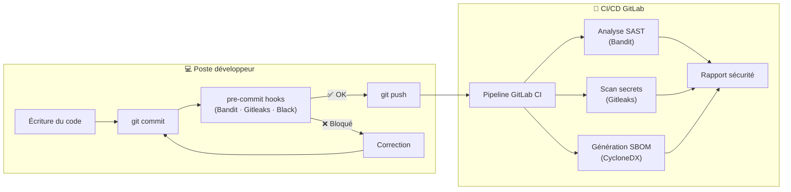
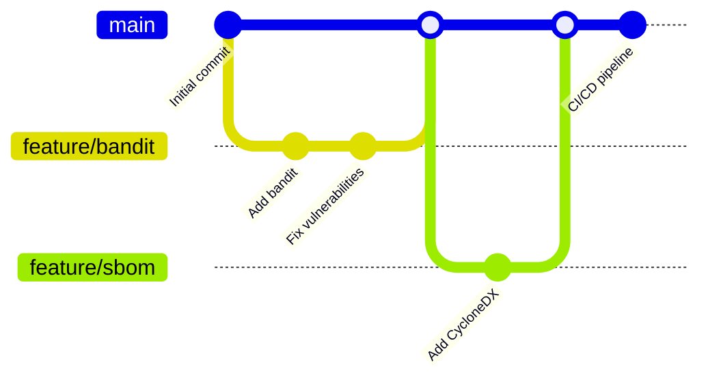
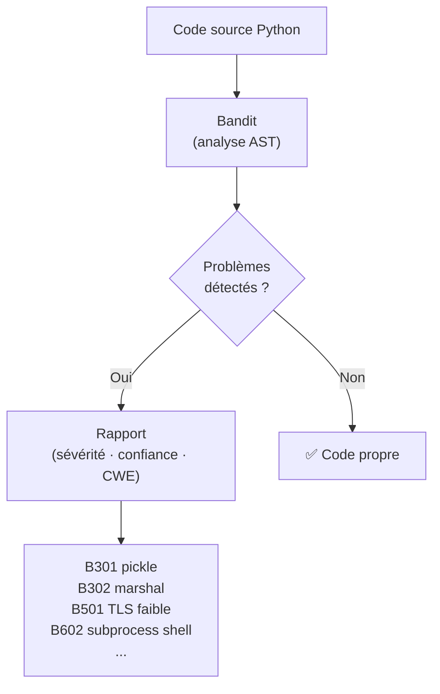
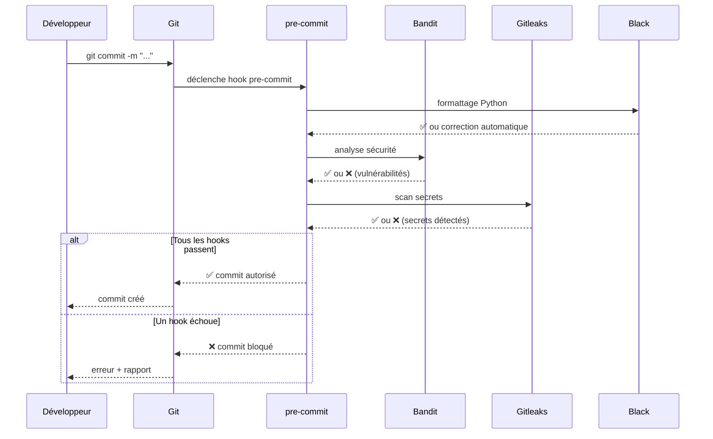
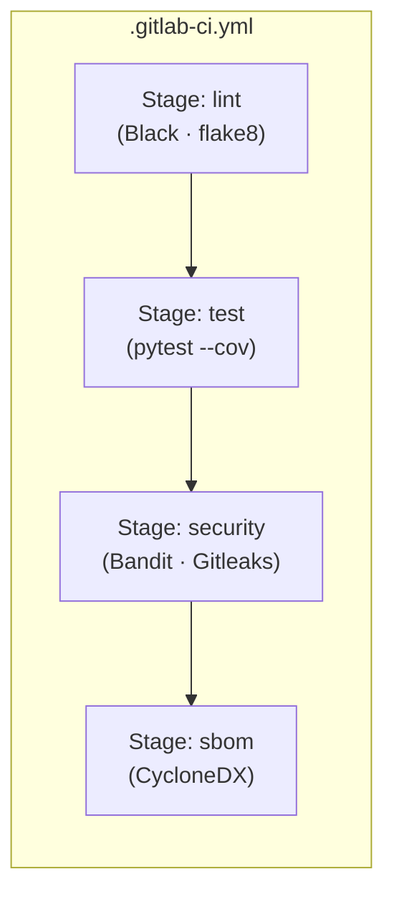
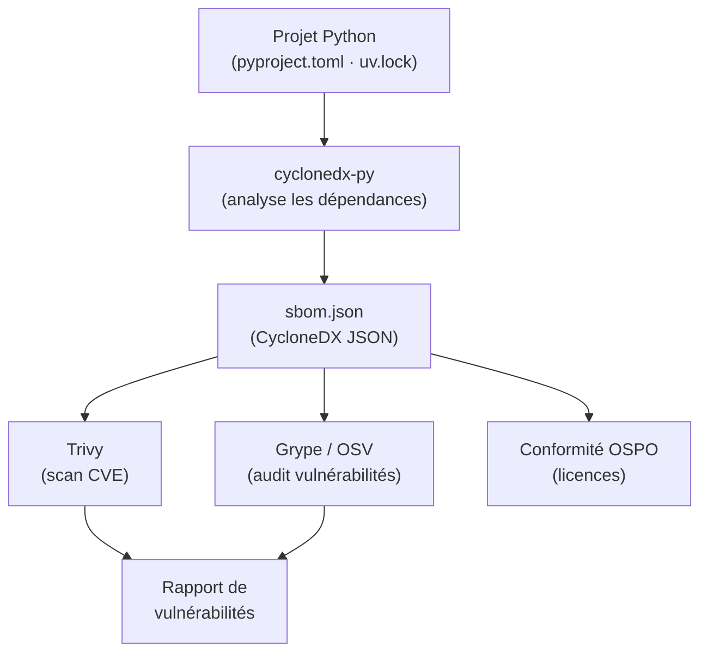
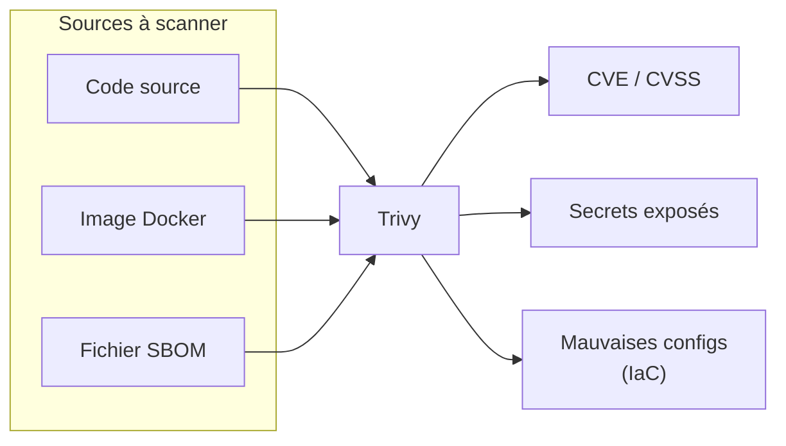

L'objectif de ce TP est de monter en compétence sur la mise en place d'outils dans une démarche **DevSecOps** : détection de vulnérabilités avec [Bandit](https://github.com/PyCQA/bandit), détection de secrets exposés avec [Gitleaks](https://github.com/gitleaks/gitleaks), et génération d'un [SBOM CycloneDX](https://cyclonedx.org/) pour vos projets Python.



---

## Étape -1 — Créer le projet avec uv

:::tip[Rappel TP1]
Cette étape reprend exactement les bases du TP1. Si votre projet Flask est déjà fonctionnel, passez directement à l'[Étape 0](#étape-0--collaboration-sur-gitlab).
:::

### Initialiser le projet

```bash
uv init tp3sbom
cd tp3sbom
```

### Ajouter Flask

```bash
uv add flask
```

### Créer l'application Flask

Créer le fichier `tp3sbom/main.py` :

```python
from flask import Flask

def create_app():
    app = Flask(__name__)

    @app.route("/")
    def hello_world():
        return "<p>Hello, World!</p>"

    return app

create_app()
```

### Lancer l'application

```bash
uv run flask --app tp3sbom.main run
```

Ouvrez http://127.0.0.1:5000/ pour vérifier.

### Ajouter les tests

```bash
uv add --dev pytest-flask pytest-cov
```

Créer `tests/conftest.py` :

```python
import pytest
from tp3sbom.main import create_app

@pytest.fixture
def client():
    app = create_app()
    with app.test_client() as client:
        yield client
```

Créer `tests/test_app.py` :

```python
from tests.conftest import client

def test_should_status_code_ok(client):
    response = client.get('/')
    assert response.status_code == 200

def test_should_contain_helloworld(client):
    response = client.get('/')
    data = response.data.decode()
    assert data == '<p>Hello, World!</p>'
```

```bash
uv run pytest --cov
```

---

## Étape 0 — Collaboration sur GitLab

En binôme, un seul des deux membres crée un projet **blank** sur [GitLab ISTIC](https://gitlab2.istic.univ-rennes1.fr/).

:::caution
Désélectionnez **"Initialize repository with a README"** pour garder un dépôt vide.
:::

```bash
git config --global user.name "Prénom Nom"
git config --global user.email "prenom.nom@univ-rennes.fr"

git init --initial-branch=main
git remote add origin git@gitlab2.istic.univ-rennes1.fr:VOTRE_LOGIN/tp3sbom.git

wget https://raw.githubusercontent.com/github/gitignore/main/Python.gitignore
mv Python.gitignore .gitignore

git add README.md tp3sbom/ tests/ uv.lock pyproject.toml .gitignore
git commit -m 'Initial commit'
git push --set-upstream origin main
```



---

## Étape 1 — Analyse statique avec Bandit

[Bandit](https://github.com/PyCQA/bandit) est un outil d'analyse statique de sécurité pour Python. Il parcourt l'AST (arbre syntaxique) de votre code pour y détecter des patterns de sécurité problématiques.

### Installation

```bash
uv add --dev bandit
```

### Première analyse

```bash
uv run bandit tp3sbom/*.py
```

### Travail à faire 1 — Analyser des exemples

Récupérez quelques scripts d'exemple depuis le dépôt [BanditPythonSamples](https://github.com/ReyhanehA/BanditPythonSamples) et analysez-les avec Bandit :

```bash
git clone https://github.com/ReyhanehA/BanditPythonSamples /tmp/bandit-samples
uv run bandit /tmp/bandit-samples/*.py -f txt
```

Observez les niveaux de sévérité (`LOW`, `MEDIUM`, `HIGH`) et de confiance (`LOW`, `MEDIUM`, `HIGH`).

### Travail à faire 2 — Injection de commande

Ajoutez une route vulnérable à votre application, qui prend un paramètre URL et l'exécute via `subprocess` :

```python
# À ajouter dans main.py — EXEMPLE VOLONTAIREMENT VULNÉRABLE
import subprocess
from flask import request

@app.route("/run")
def run_command():
    cmd = request.args.get("cmd", "echo hello")
    # ⚠️ VULNÉRABILITÉ : injection de commande
    result = subprocess.run(cmd, shell=True, capture_output=True, text=True)
    return f"<pre>{result.stdout}</pre>"
```

Relancez Bandit et observez son rapport :

```bash
uv run bandit tp3sbom/*.py -l
```

:::danger[Ne jamais faire ça en production !]
`shell=True` avec une entrée utilisateur non validée est une vulnérabilité critique d'**injection de commande** (CWE-78). Bandit doit le détecter avec une sévérité `HIGH`.
:::



---

## Étape 2 — Intégration dans pre-commit

Les [Git hooks](https://git-scm.com/book/fr/v2/Personnalisation-de-Git-Crochets-Git) permettent d'exécuter automatiquement des vérifications **avant** chaque `git commit`. Le projet [pre-commit](https://pre-commit.com/) est un gestionnaire de hooks multi-langages.



### Installation de pre-commit

```bash
uv add --dev pre-commit
```

### Créer la configuration `.pre-commit-config.yaml`

```yaml
repos:
  # Hooks généraux
  - repo: https://github.com/pre-commit/pre-commit-hooks
    rev: v4.5.0
    hooks:
      - id: check-yaml
      - id: end-of-file-fixer
      - id: trailing-whitespace
      - id: check-added-large-files

  # Formattage Python avec Black
  - repo: https://github.com/psf/black
    rev: 24.1.0
    hooks:
      - id: black

  # Analyse de sécurité Python avec Bandit
  - repo: https://github.com/PyCQA/bandit
    rev: 1.7.6
    hooks:
      - id: bandit
        args: ["-c", "pyproject.toml"]

  # Détection de secrets avec Gitleaks
  - repo: https://github.com/gitleaks/gitleaks
    rev: v8.18.1
    hooks:
      - id: gitleaks
```

### Installer les hooks git

```bash
uv run pre-commit install
# pre-commit installed at .git/hooks/pre-commit
```

### Tester sur tous les fichiers

```bash
uv run pre-commit run --all-files
```

### Configurer Bandit dans pyproject.toml

```toml
[tool.bandit]
exclude_dirs = ["tests", ".venv"]
skips = []
```

### Travail à faire — Tester le blocage

1. Ajoutez une fausse clé API dans votre code :
   ```python
   # À ne JAMAIS faire en vrai !
   AWS_SECRET = "wJalrXUtnFEMI/K7MDENG/bPxRfiCYEXAMPLEKEY"
   ```
2. Tentez un `git commit` et observez Gitleaks bloquer le commit.
3. Retirez la clé, recommittez.

---

## Étape 3 — Intégration CI/CD GitLab



Créez le fichier `.gitlab-ci.yml` à la racine :

```yaml
image: python:3.12-slim

variables:
  UV_VERSION: "0.5.0"

stages:
  - lint
  - test
  - security
  - sbom

.uv-setup: &uv-setup
  before_script:
    - pip install uv==$UV_VERSION
    - uv sync --all-extras

lint:
  stage: lint
  <<: *uv-setup
  script:
    - uv run black --check .
    - uv run pre-commit run --all-files

test:
  stage: test
  <<: *uv-setup
  script:
    - uv run pytest --cov=tp3sbom --cov-report=xml
  coverage: '/TOTAL.*\s+(\d+%)$/'
  artifacts:
    reports:
      coverage_report:
        coverage_format: cobertura
        path: coverage.xml

bandit:
  stage: security
  <<: *uv-setup
  script:
    - uv run bandit -r tp3sbom/ -f json -o bandit-report.json || true
    - uv run bandit -r tp3sbom/
  artifacts:
    when: always
    paths:
      - bandit-report.json

gitleaks:
  stage: security
  image: zricethezav/gitleaks:latest
  script:
    - gitleaks detect --source . --verbose
  allow_failure: false

sbom:
  stage: sbom
  <<: *uv-setup
  script:
    - uv add --dev cyclonedx-bom
    - uv run cyclonedx-py environment -o sbom.json --of json
  artifacts:
    paths:
      - sbom.json
    expire_in: 30 days
```

**Travail à faire** — Poussez votre code et vérifiez que le pipeline s'exécute correctement.

---

## Étape 4 — Génération du SBOM avec CycloneDX

Un **Software Bill of Materials (SBOM)** est un inventaire exhaustif de toutes les dépendances (directes et transitives) de votre projet.



### Installation

```bash
uv add --dev cyclonedx-bom
```

### Générer le SBOM

```bash
# Format JSON (recommandé)
uv run cyclonedx-py environment -o sbom.json --of json

# Format XML
uv run cyclonedx-py environment -o sbom.xml --of xml
```

**Travail à faire** — Intégrez la génération du SBOM dans votre pipeline GitLab CI et publiez le fichier en artefact (voir l'étape 3).

---

## Pour aller plus loin

### Trivy — Scanner de vulnérabilités complet

```bash
# Scanner le code source
docker run -v $(pwd):/project aquasec/trivy fs /project --scanners vuln,secret,misconfig

# Scanner à partir du SBOM généré
uv run cyclonedx-py environment -o sbom.json --of json
docker run -v $(pwd):/project aquasec/trivy sbom /project/sbom.json

# Scanner l'image Docker Python utilisée en production
docker pull python:3.12-slim
docker run -v /var/run/docker.sock:/var/run/docker.sock \
  aquasec/trivy image python:3.12-slim
```



### Pysa — Analyse de flux de données (Meta)

[Pysa](https://engineering.fb.com/2020/08/07/security/pysa/) effectue une analyse de **taint** (contamination des données) pour détecter les injections SQL, XSS, path traversal, etc.

- [Documentation Pysa](https://pyre-check.org/docs/pysa-basics/)
- [Action GitHub Pysa](https://github.com/facebook/pysa-action)

---

## Ressources

- [Bandit — documentation officielle](https://bandit.readthedocs.io/)
- [Gitleaks — dépôt GitHub](https://github.com/gitleaks/gitleaks)
- [CycloneDX Python](https://github.com/CycloneDX/cyclonedx-python)
- [Trivy — Aqua Security](https://trivy.dev/)
- [OWASP Top 10 CI/CD Security Risks](https://owasp.org/www-project-top-10-ci-cd-security-risks/)
- [SLSA — Supply chain Levels for Software Artifacts](https://slsa.dev/)
