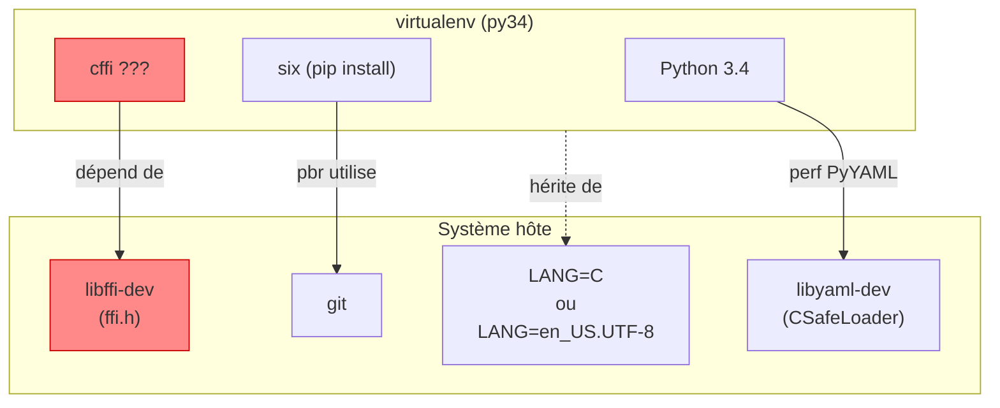
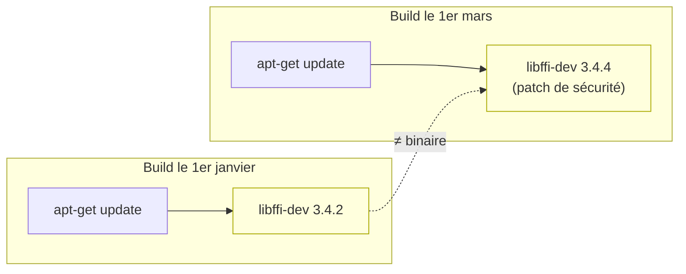
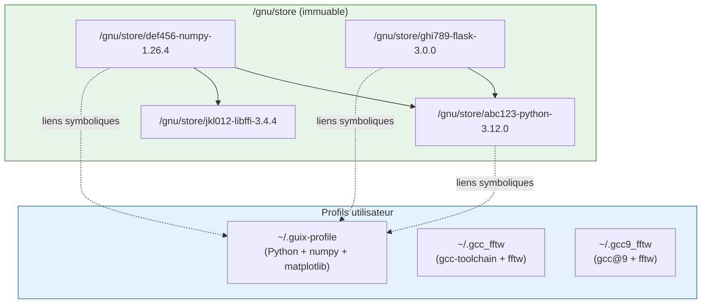
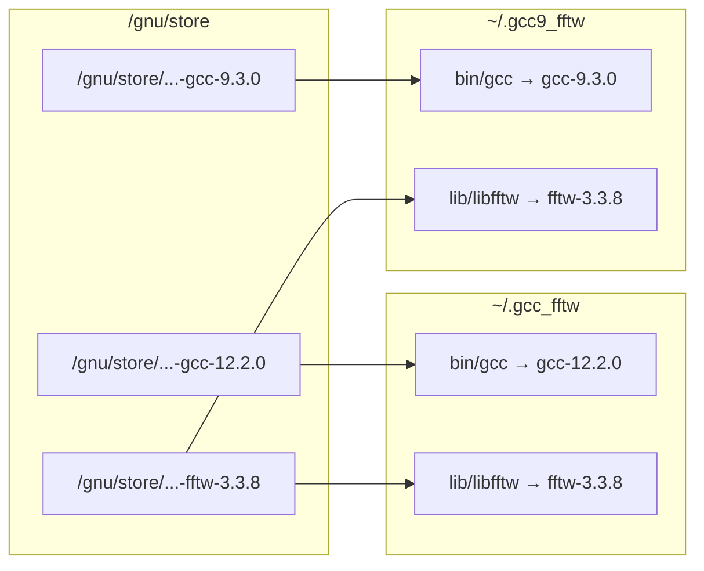
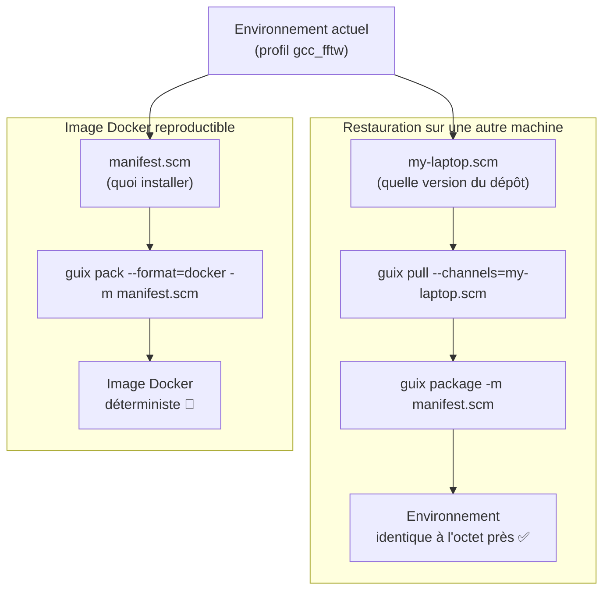
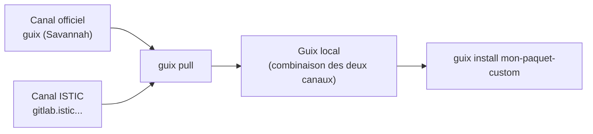
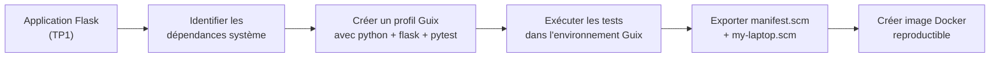

Ce TP est construit à partir de [plusieurs sources](#références) et vise à bien comprendre la difficulté d'obtenir un environnement de build **reproductible**, puis à montrer comment **GNU Guix** résout ces problèmes là où virtualenv et Docker montrent leurs limites.

---

## Partie 1 — Pourquoi la reproductibilité est difficile

### Les limites de virtualenv

`virtualenv` est très populaire chez les développeurs Python : il permet d'isoler des paquets sans toucher au système. Mais cette isolation est **incomplète**.



**Quatre problèmes concrets :**

**1 — Dépendance système manquante (erreur d'installation)**

```bash
(py34)$ pip install cffi
# c/_cffi_backend.c:15:17: fatal error: ffi.h: No such file or directory
# → nécessite libffi-dev installé sur le système hôte
```

**2 — Dépendance exécution invisible** : `pbr` (OpenStack) requiert `git` à l'exécution — un `apt remove git` casse silencieusement l'environnement virtuel.

**3 — Performances non reproductibles** : PyYAML utilise `CSafeLoader` (C, 3,5× plus rapide) si `libyaml-dev` est présent — deux machines avec le même virtualenv peuvent avoir des performances radicalement différentes.

**4 — Variables d'environnement** : un simple `LANG=C` vs `LANG=en_US.UTF-8` change le comportement d'un programme Python qui affiche des caractères accentués :

```bash
$ LANG=C python3 -c "print('é')"
# UnicodeEncodeError: surrogates not allowed

$ LANG=en_US.UTF-8 python3 -c "print('é')"
# é
```

:::caution[Conclusion]
`virtualenv` isole les **paquets Python**, mais pas les bibliothèques système, les binaires externes, ni les variables d'environnement. L'environnement n'est pas vraiment reproductible.
:::

### Pourquoi Docker ne suffit pas non plus

Dans la plupart des `Dockerfile`, on commence par :

```dockerfile
FROM ubuntu:22.04
RUN apt-get update && apt-get install -y python3 libffi-dev
```



Le résultat dépend du **moment de la construction**. Sans figer les versions binaires exactes de tous les paquets, deux builds de la même image peuvent produire des artefacts différents.

:::tip[C'est là qu'intervient Guix]
GNU Guix identifie chaque paquet par un **hash cryptographique** de l'ensemble de ses entrées (sources, dépendances, options de compilation). Le même hash produit **toujours** le même binaire, sur n'importe quelle machine, à n'importe quelle date.
:::

---

## Partie 2 — Qu'est-ce que GNU Guix ?



Guix est un gestionnaire de paquets **fonctionnel** (inspiré de Nix) :

- Chaque paquet est stocké dans `/gnu/store` sous un chemin incluant son hash
- Les profils utilisateur ne sont que des **liens symboliques** vers le store
- Plusieurs versions du même paquet coexistent sans conflit
- Pas besoin d'être `root` pour installer des paquets
- Le store est **immuable** : un paquet installé ne change jamais

---

## Partie 3 — Installation de Guix

:::note[Prérequis]
Seul prérequis : GNU tar et xz. L'installation se fait en tant que `root`.
:::

```bash
cd /tmp
wget https://cgit.git.savannah.gnu.org/cgit/guix.git/plain/etc/guix-install.sh
chmod +x guix-install.sh
sudo ./guix-install.sh
```

:::caution[Réseau eduroam]
L'installation peut échouer sur eduroam. Dans ce cas, désinstallez avec `./guix-install.sh --uninstall` et relancez sur un autre réseau.
:::

Vérifiez que l'installation fonctionne :

```bash
guix install hello
hello   # → Hello, World!
```

Mise à jour de l'arbre des paquets (optionnel en TP, peut prendre plusieurs heures) :

```bash
guix pull
```

---

## Partie 4 — Tutoriel : Python avec numpy et matplotlib

### Rechercher des paquets

```bash
guix search python
guix search numpy
# Sortie très verbeux — préférez la liste en ligne :
# https://www.gnu.org/software/guix/packages/
```

### Installer dans le profil par défaut

```bash
guix install python@3 python-numpy@1.26.4 python-matplotlib emacs
```

### Activer le profil

```bash
export GUIX_PROFILE="$HOME/.guix-profile"
. "$GUIX_PROFILE/etc/profile"
```

:::caution[À ne pas oublier]
Sourcez `~/.guix-profile/etc/profile` **à chaque nouvelle session de terminal**, sinon votre environnement Guix ne sera pas disponible. Ajoutez-le à votre `~/.bashrc` ou `~/.profile`.
:::

```bash
which python3
# → /home/barais/.guix-profile/bin/python3

python3 -c "import numpy as np; print(np.__version__)"
# → 1.26.4
```

### Vérifier ce qui est installé

```bash
guix package -I
```

```
glibc-locales   2.29  out  /gnu/store/03nv...-glibc-locales-2.29
emacs           26.3  out  /gnu/store/lza7...-emacs-26.3
python          3.12  out  /gnu/store/fa1z...-python-3.12.0
python-numpy    1.26  out  /gnu/store/rr1w...-python-numpy-1.26.4
python-matplotlib 3.8 out  /gnu/store/gsjh...-python-matplotlib-3.8.0
```

:::tip
Le `~/.guix-profile` ne contient que des **liens symboliques** vers `/gnu/store`. Si quelqu'un d'autre a déjà installé le même paquet, Guix crée simplement les liens — il ne retélécharge rien.
:::

---

## Partie 5 — Gestion de profils multiples

Les profils permettent d'avoir plusieurs environnements de travail **complètement isolés**, sans interférence.



### Installer dans un profil nommé

```bash
# Profil avec GCC 12 + FFTW
guix install -p ~/.gcc_fftw gcc-toolchain fftw

# Profil avec GCC 9 + FFTW
guix install -p ~/.gcc9_fftw gcc-toolchain@9 fftw
```

### Activer un profil et passer de l'un à l'autre

```bash
# Réinitialiser l'environnement et activer gcc_fftw
ENVVA="$(env -i TERM="$TERM" HOME="$HOME" LC_CTYPE="${LC_ALL:-${LC_CTYPE:-$LANG}}" \
  USER="$USER" DISPLAY="$DISPLAY" bash -c -i \
  "source <(cat /etc/environment /etc/profile $HOME/.profile 2>/dev/null) && \
  /usr/bin/printenv" | \
  sed -e 's/=/="/' -e 's/$/"/' | sed 's/^/export /')"; \
  for i in $(env | sed 's/=.*//'); do \
    [ "$i" = "ENVVA" ] && echo $i || unset $i; \
  done; eval "$ENVVA"

# Activer GCC 12
export GUIX_PROFILE="$HOME/.gcc_fftw"
. "$GUIX_PROFILE/etc/profile"
gcc --version   # → gcc (GCC) 12.2.0

# Activer GCC 9 (même procédure, autre profil)
export GUIX_PROFILE="$HOME/.gcc9_fftw"
. "$GUIX_PROFILE/etc/profile"
gcc --version   # → gcc (GCC) 9.3.0
```

### Lister tous les profils

```bash
guix package --list-profiles
# /home/barais/.guix-profile
# /home/barais/.gcc9_fftw
# /home/barais/.gcc_fftw
```

### Supprimer un paquet ou un profil

```bash
guix remove -p ~/.gcc9_fftw fftw   # Supprimer un paquet
rm -rf ~/.gcc9_fftw                # Supprimer un profil entier
```

---

## Partie 6 — Reproductibilité : manifest et time machine

C'est la partie centrale du TP. L'objectif est de **capturer l'état exact** d'un environnement pour le recréer à l'identique sur n'importe quelle machine, maintenant ou dans 5 ans.



### Créer le manifest

```bash
guix package --export-manifest -p ~/.gcc_fftw > manifest.scm
```

Le fichier `manifest.scm` ressemble à :

```scheme
(specifications->manifest
 '("gcc-toolchain"
   "fftw"))
```

### Sauvegarder l'état de l'arbre Guix

```bash
guix describe --format=channels > my-laptop.scm
```

Le fichier `my-laptop.scm` contient l'état précis du canal Guix (commit git exact) :

```scheme
(list (channel
        (name 'guix)
        (url "https://git.savannah.gnu.org/git/guix.git")
        (commit "abc123def456...")
        (introduction ...)))
```

:::tip[La combinaison gagnante]
`manifest.scm` = **ce qu'on installe** · `my-laptop.scm` = **dans quelle version de l'arbre**.

Ces deux fichiers ensemble permettent de recréer un environnement bit-à-bit identique. Guix ira chercher les binaires dans le cache web ou les sources dans [Software Heritage](https://www.softwareheritage.org/) si certains ne sont plus accessibles.
:::

### Créer une image Docker reproductible

```bash
guix pack --format=docker -m manifest.scm
# Crée un fichier *-docker-pack.tar.gz dans /gnu/store
```

Chargez-la en local :

```bash
docker load < /gnu/store/*-docker-pack.tar.gz
docker tag <hash> mon-env-gcc-fftw:v1
docker push mon-registry/mon-env-gcc-fftw:v1
```

### Revenir à un état passé (time machine)

```bash
# Par commit exact
guix time-machine --commit=c61df1792c -- install python -p python/autres

# Ou utiliser un fichier channels.scm sauvegardé
guix pull --channels=my-laptop.scm
```

---

## Partie 7 — Canaux personnalisés



Créez `~/.config/guix/channels.scm` :

```scheme
(cons (channel
        (name 'istic_guix_packages)
        (url "https://gitlab.istic.univ-rennes1.fr/barais/guix_packages.git"))
      %default-channels)
```

```bash
guix pull
# Updating channel 'istic-guix-packages' from Git repository at '...'
# Updating channel 'guix' from Git repository at '...'
```

---

## Exercice — Environnement reproductible pour votre TP1

L'objectif est de préparer un environnement Guix permettant d'exécuter votre application Flask du TP1, et d'en sauvegarder l'état de façon reproductible.



**1. Créer un profil Guix pour le TP1**

```bash
guix install -p ~/.tp1-env python@3 python-flask python-pytest python-pytest-flask
export GUIX_PROFILE="$HOME/.tp1-env"
. "$GUIX_PROFILE/etc/profile"
```

**2. Vérifier que les tests passent**

```bash
cd ~/tp1flask
python -m pytest tests/
```

**3. Exporter le manifest**

```bash
guix package --export-manifest -p ~/.tp1-env > manifest.scm
```

**4. Sauvegarder l'état de l'arbre Guix**

```bash
guix describe --format=channels > my-laptop.scm
```

**5. Créer l'image Docker reproductible**

```bash
guix pack --format=docker -m manifest.scm
```

**6. Vérifier la reproductibilité avec votre binôme**

Partagez `manifest.scm` et `my-laptop.scm`. Votre binôme doit pouvoir recréer exactement le même environnement :

```bash
guix pull --channels=my-laptop.scm
guix package -m manifest.scm -p ~/.tp1-env-reproduced
```

**Livrables attendus** : les fichiers `manifest.scm` et le fichier issu de `guix describe --format=channels`, committés dans votre dépôt GitLab.

---

## Aide-mémoire Guix

### Démarrer une session

```bash
source ~/.guix-profile/etc/profile
```

### Recherche et installation

```bash
guix search <nom>                           # Rechercher
guix install <paquet>                       # Profil par défaut
guix install -p ~/.mon-profil <paquet>      # Profil nommé
guix remove <paquet>                        # Désinstaller
guix package -I                             # Lister les installés
guix package -p ~/.mon-profil -I            # Lister dans un profil
```

### Profils

```bash
guix package --list-profiles                # Tous vos profils
guix shell --container -p ~/.mon-profil     # Tester en bac à sable
```

### Reproductibilité

```bash
guix package --export-manifest > manifest.scm
guix package --export-manifest -p ~/.mon-profil > manifest.scm
guix describe --format=channels > channels.scm
guix pull --channels=channels.scm
guix time-machine --commit=<hash> -- install <pkg>
guix pack --format=docker -m manifest.scm
```

### Maintenance

```bash
guix pull                       # Mettre à jour l'arbre des paquets
guix package -u                 # Mettre à jour tous les paquets
guix package -p <profil> -u     # Mettre à jour un profil
guix gc                         # Nettoyage du store
```

---

## Références

- [1] [GRICAD — HPC Guix documentation](https://gricad-doc.univ-grenoble-alpes.fr/hpc/softenv/guix/)
- [2] [GNU-Linux Magazine — Python avec GNU Guix](https://connect.ed-diamond.com/GNU-Linux-Magazine/glmf-195/python-un-environnement-vraiment-isole-avec-gnu-guix)
- [3] [GNU-Linux Magazine — Gestion de paquets avec GNU Guix](https://connect.ed-diamond.com/GNU-Linux-Magazine/GLMF-194/Gestion-de-paquets-sure-et-flexible-avec-GNU-Guix)
- [4] [JRES 2021 — Guix dans l'enseignement supérieur](https://conf-ng.jres.org/2021/document_revision_2595.html?download)
- [5] [Site officiel GNU Guix](https://guix.gnu.org/)
- [6] [Guix Cookbook — Conteneurs](https://guix.gnu.org/cookbook/fr/html_node/Conteneurs-Guix.html)
